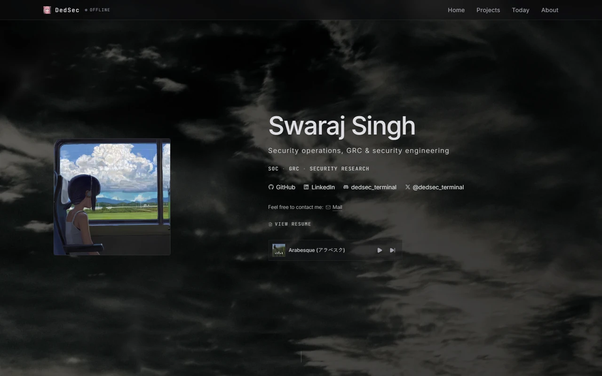
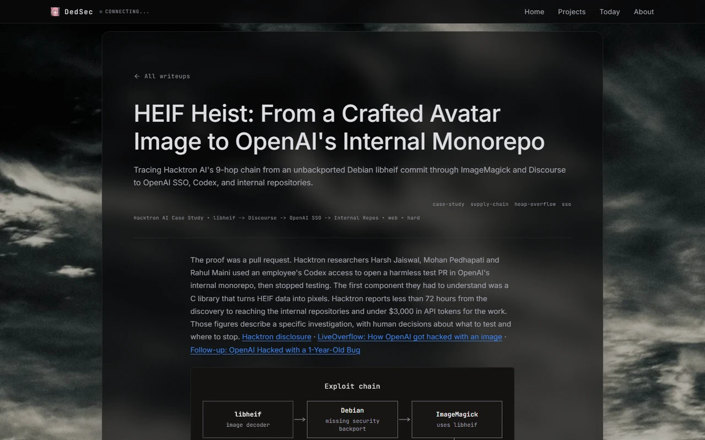
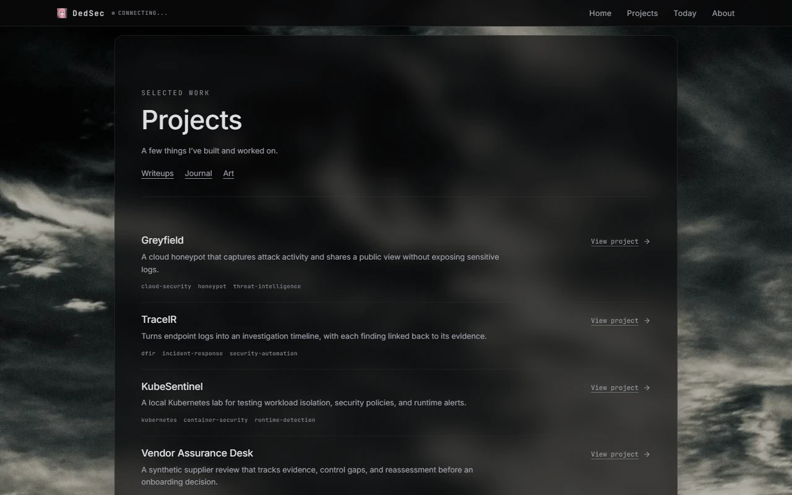
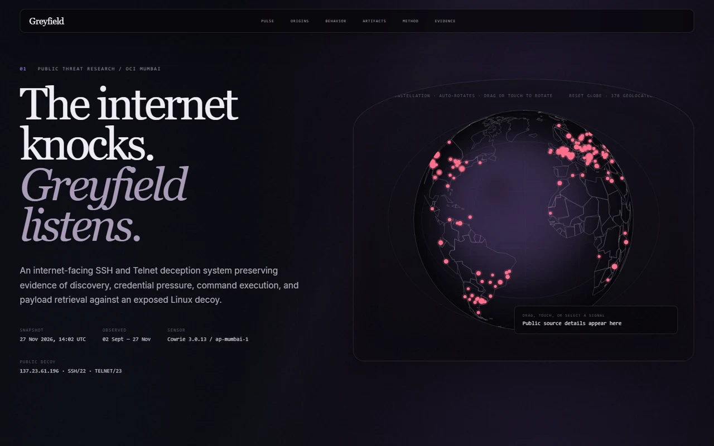
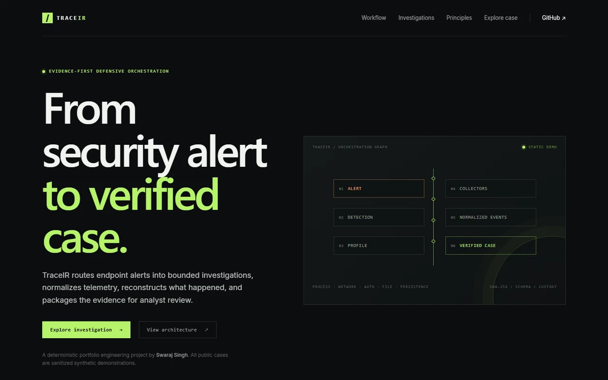
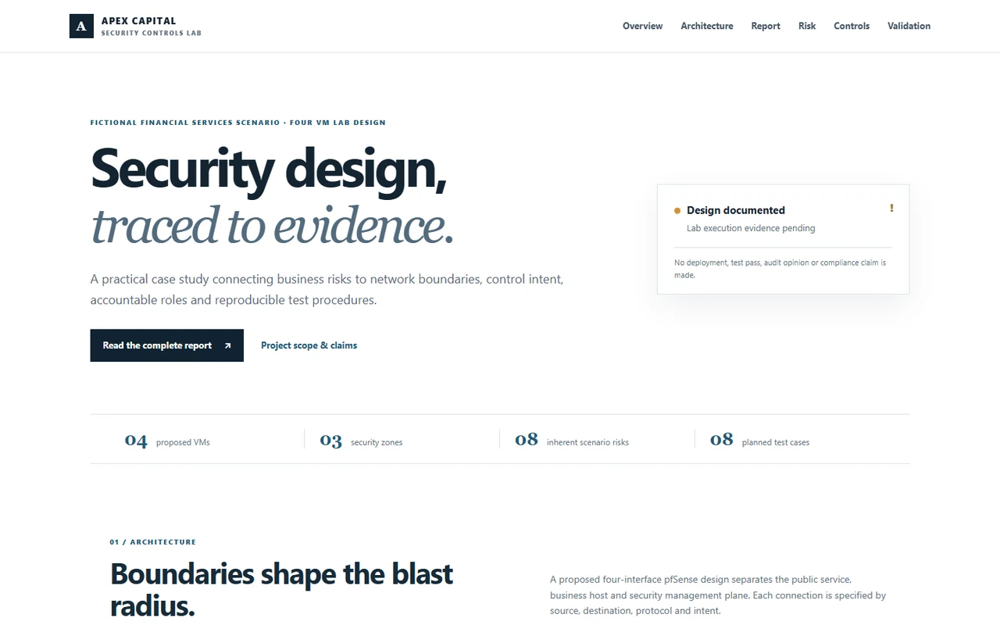
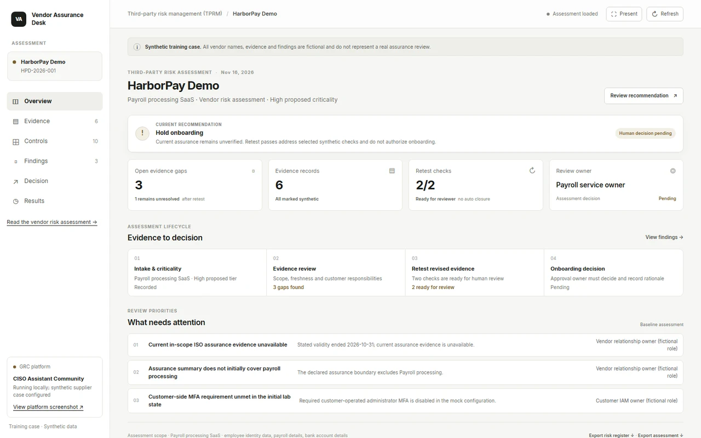
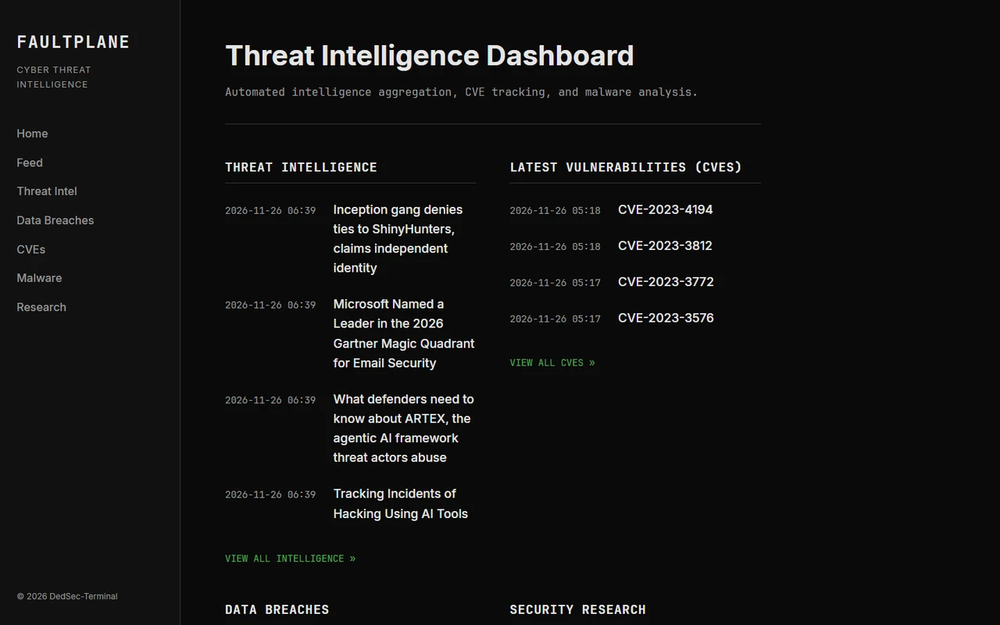
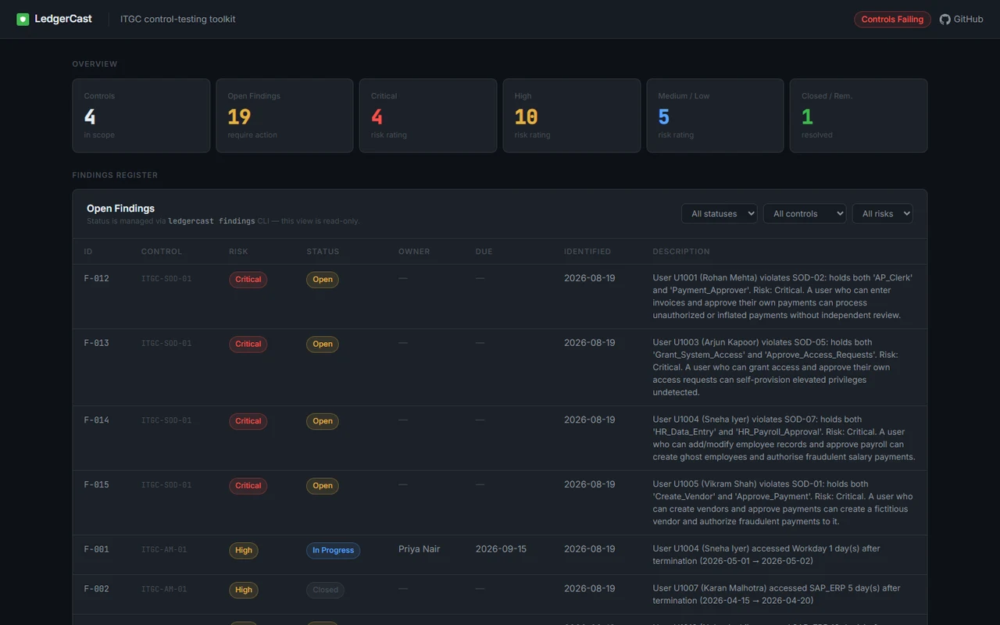

# Dedsec Terminal | Cybersecurity Portfolio of Swaraj Singh

Personal portfolio of **Swaraj Singh**, focused on Security Operations (SOC), Governance, Risk & Compliance (GRC), Threat Intelligence, and Security Engineering. Published as **[dedsec-terminal.in](https://dedsec-terminal.in/)**.



## Architecture & Highlights

- **Security Writeups & Case Studies (`src/content/writeups/`):** In-depth breakdowns covering real-world exploit chains (`PHP2Shell`, `HEIF Heist`), parser differentials, normalization boundaries, and detection-engineering regression tests, rendered with zero-dependency server-side Mermaid chain diagrams ([MermaidDiagram.tsx](src/components/content/MermaidDiagram.tsx)).
- **Hands-On Projects (`src/content/projects/`):** 11 documented engineering and security lab builds paired with live deployments, architecture flowcharts, and repository-grounded documentation.
- **Journal & Art (`src/content/journal/`, `src/content/art/`):** Long-form essays, narrative notes, and curated visual works.

<details>
<summary>Preview: Technical Writeup Chain Diagram &amp; Projects Directory</summary>





</details>

## Featured Security Projects

| Project | Focus | Live Demo | Preview |
|---|---|---|---|
| **Greyfield** | Cloud Cowrie SSH/Telnet honeypot & anonymized threat telemetry | [Live Site](https://dedsec-terminal.github.io/greyfield/) | [](public/content/projects/greyfield/live.webp) |
| **TraceIR** | Evidence-first DFIR alert-to-timeline orchestration | [Live Site](https://dedsec-terminal.github.io/TraceIR/) | [](public/content/projects/traceir/live.webp) |
| **Apex Capital GRC** | 4-VM security controls lab traced from risk to verification | [Live Site](https://dedsec-terminal.github.io/Apex-Capital-GRC/) | [](public/content/projects/apex-capital-grc/live.webp) |
| **Vendor Assurance Desk** | Synthetic TPRM assessment & evidence-retest workflow | [Live Site](https://dedsec-terminal.github.io/Vendor-Assurance-Desk/) | [](public/content/projects/vendor-assurance-desk/live.webp) |
| **Faultplane** | Automated NVD 2.0, CISA KEV & advisory aggregator | [Live Site](https://dedsec-terminal.github.io/Faultplane/) | [](public/content/projects/faultplane/live.webp) |
| **LedgerCast** | ITGC control-testing & Segregation-of-Duties findings register | [Live Site](https://dedsec-terminal.github.io/LedgerCast/) | [](public/content/projects/ledgercast/live.webp) |

## Local Development & Verification

```bash
npm install
npm run dev
```

Open [http://localhost:3000](http://localhost:3000) in your browser. Validate content schemas, TypeScript types, production static build, and SEO metadata with:

```bash
npm run content:check && npm run typecheck && npm run build && npm run verify:seo
```
