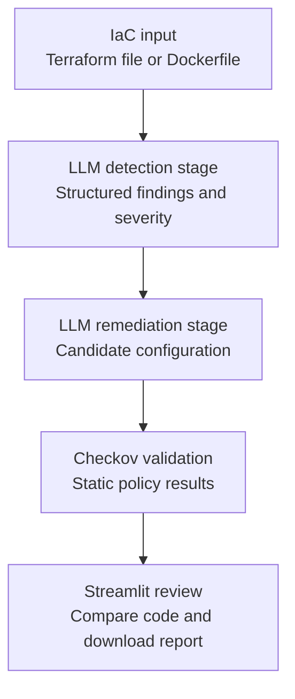

A scanner can tell me that a configuration violates a policy. The next step is where the work often slows down. Which lines need to change, what assumptions does the proposed edit make, and how do I check it before anyone relies on it? This project explores that next step for Terraform and Dockerfiles. It combines model-generated findings and candidate edits with a Checkov policy scan and a Streamlit view for comparing the results.

*The repository snapshot shows the project and its documentation. The workflow's comparison and reporting interface is built in Streamlit.*

## Give each stage a specific job

The documented workflow starts when someone uploads a Terraform file or Dockerfile. A detection stage uses GPT-4o Mini to analyze the input and produce structured findings. Each finding can be classified as critical, high, medium, or low. The remediation stage generates a candidate version of the infrastructure code. Checkov then evaluates the candidate against its static policies. The interface presents the reported findings, the original and remediated code, and the validation results, with an option to download the security report.

The important handoff is from the proposed edit to an evaluation with a different basis. The model generates an explanation and a change. The static scanner evaluates configuration against the checks it can apply. That gives the reviewer two kinds of material to examine. For example, a plausible explanation about restricted access is a claim about the edit. A policy result helps show whether the configuration satisfies a particular encoded check. Looking at the code alongside both results lets a reader judge whether the edit matches the intent of the original configuration.

## Follow an example through the review

The README uses open network access, public storage, unencrypted volumes, broad IAM permissions, and root containers as examples of the kinds of misconfiguration considered. Take a storage configuration flagged for missing encryption. A useful finding identifies the configuration under review and explains why the exposure matters. A useful proposal makes the particular change legible in the comparison view. The static result then indicates whether the applicable policy check still flags the candidate. The example illustrates the workflow. The supplied repository description provides no recorded test output for that particular example.

The same reasoning applies when a change involves an access boundary. Replacing a broadly scoped permission can leave a downstream consumer without the permission it needs. A Dockerfile change aimed at running as a non-root user can raise questions about which files the process needs to read or write. The diff gives the reviewer somewhere concrete to look for those effects. Whether the surrounding system would still work requires context beyond the snippet and may require a build or deployment test. A severity label helps order the review, while the consequences still depend on the workload and environment.

## Understand the policy result

Checkov gives the workflow a policy-based check outside the model's own explanation. The limits of that evidence matter. A result applies to the policies, input, and configuration context the scanner evaluated. It leaves open whether a Terraform plan would succeed with real provider settings, whether related resources change the effective permissions, or whether the application would run correctly inside the revised container. The project documents a scan of the proposed configuration. There is no recorded claim here of applying the proposed changes to cloud resources or verifying a running workload.

The comparison view is where those boundaries become practical. It gives someone assessing a suggestion a chance to connect the finding to its proposed edit and check what else changed. The downloadable report carries the review result beyond the immediate interface. A report can help hand off a decision about a candidate. The decision still needs the person responsible for the infrastructure to account for dependencies and constraints the uploaded file may never show.

## What the prototype covers

The implementation described in the README supports Terraform and Dockerfiles, uses Python for the workflow, Checkov for static validation, and Streamlit for reporting and comparison. It demonstrates a pre-deployment review path that produces candidate remediations and policy results. The repository description does not establish production detection accuracy, show a measured reduction in deployed incidents, or establish that a suggested edit is operationally safe.

CI/CD integration, automated pull request generation, Kubernetes YAML and CloudFormation support, broader cloud coverage, and local models appear as future work in the README. The current project focuses on making the transition from a reported issue to a proposed change inspectable. The [repository](https://github.com/dedsec-terminal/IaC-Vulnerability-Detection-Remediation) documents that scope and the components involved. The useful review question at the end is concrete. Given this input, this explanation, this diff, and these policy results, what would still have to be checked before the change could be applied?

The same distinction applies when a scan still reports a problem. A reviewer can compare the failed check with the model's explanation, locate the affected section in the original and candidate files, and see whether the suggested change addressed the same concern. Keeping the code comparison available makes that discrepancy easier to inspect. It also leaves room for a reviewer to reject a change whose implementation is wider than the finding, even if the targeted check passes. The documented workflow ends with reporting results for review.
