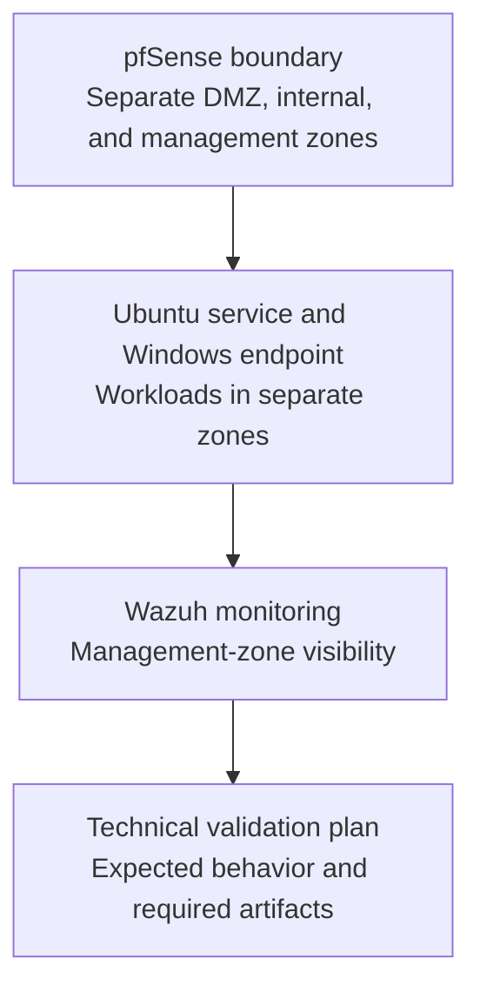

Apex Capital starts with a question that is easy to skip when drawing a network diagram. What does the business need to keep working when something goes wrong? I used a fictional financial-services organization to follow that question from business requirements to an eight-risk register, a proposed network, and the evidence someone would need to judge whether the controls worked. The report follows those decisions all the way through incident response. The website lets readers move between the diagrams and the chapters that explain them.

*The published report reader brings the architecture, risk assessment, and validation plan into one place.*

## Start with the risk register

The register gives each of the eight scenario risks an explicit likelihood and impact assessment, an accountable role, and a proposed treatment. Those fields do different work. A likelihood and impact score explains the priority assigned under the scenario assumptions. The accountable role identifies who must carry the decision forward. A treatment gives that role something concrete to inspect, change, or validate. The heatmap makes the priorities visible at a glance, while the register holds the details that make them reviewable.

I wanted the report to let readers follow a control back to the business requirement it serves. A firewall rule can look sensible in a diagram while leaving open the question of which connection a business process actually needs. The permitted-flow diagrams make that question concrete. The framework crosswalk adds another view of the decisions through selected NIST CSF 2.0 outcomes and ISO/IEC 27001:2022 associations. Those references help organize the requirements and evidence. The mapping covers selected controls within the fictional scope, and the report claims no regulatory compliance or certification.

## Put the boundaries on the drawing

The design uses four VMs. pfSense provides the network boundary, an Ubuntu VM hosts the web service, a Windows VM represents the internal endpoint, and Wazuh provides monitoring in the management zone. Separating the DMZ, internal, and management zones makes it possible to discuss the public-facing service, user activity, and monitoring as different exposure and access problems. The documentation treats permitted network flows and monitoring telemetry as distinct views of the same design.

The diagram below follows the architecture through to its proposed validation. It reads in design order. Consult the report's permitted-flow diagrams for individual paths and rule intent.

For example, segmentation raises two validation questions. Can the required traffic get through, and does a connection outside that intended path fail? The procedure describes the traffic and expected result. Evidence collection then gives the reviewer something to inspect beyond the diagram, such as an artifact tied to the control being evaluated. Monitoring raises its own question about whether the activity would be visible to the people responsible for responding. A single result would answer only the question it was designed to test.

*Quentin Matsys, The Moneylender and His Wife (1514). Public domain, via Wikimedia Commons.*

The balance in the painting drew me to the act of checking. The decision depends on what sits on the scale and what standard it is weighed against. The register does a similar kind of work. An expected residual risk rating is a treatment target, and the validation plan specifies the evidence someone would need before revisiting that rating.

## Walk through the decisions during an incident

The incident response plan starts with activation and severity, then assigns responsibilities for evidence handling, communication, containment, and recovery. Each stage asks a different question. Activation is about when the plan comes into effect. Containment is about limiting harm given the information available at the time. Recovery requires its own criteria because restoring a service changes what the organization is willing to rely on again.

The proposed facilitated tabletop makes participants work through those choices in sequence. The useful artifact would be the record of what participants knew, what they decided, who owned the next step, and which gaps needed follow-up. That gives a later reviewer a way to evaluate the plan and recommend improvements. The technical procedures would answer whether specified controls behave as expected under lab conditions. A tabletop would show how people apply the plan, including which assumptions or responsibilities need clarification.

Supplier assurance also appears as a risk thread in the report. The separate [Vendor Assurance Desk](/projects/vendor-assurance-desk) project takes that thread into a worked synthetic review with evidence intake and reassessment.

## What the reader can verify

The [complete report](https://dedsec-terminal.github.io/Apex-Capital-GRC/site/report/) preserves the original 29 chapters and adds chapters for capability evaluation, incident response, and the tabletop. Begin with the capability evaluation to trace a decision through the business problem, the design tradeoffs, and the proposed method of measurement. The evidence register and illustrative log formats show what a future exercise would collect.

The report and its reader are published. Apex Capital is fictional, and the VM controls and tabletop remain unexecuted. Expected results and target risk ratings are design artifacts. The work demonstrates risk analysis, control design, and an evaluation plan, with no client engagement claimed.

One way to read the plan is to start at a recovery gate and work backward. Identify the role responsible for the decision, then locate the control and the artifact that would support it. That pass tests the traceability of the report itself. It also exposes the difference between having a response instruction on paper and having a way to tell, during an exercise, that the instruction was followed.
