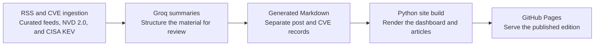

A vulnerability disclosure, a malware write-up, and a breach notice can arrive on the same morning. They all deserve a look, but they answer different questions. A vulnerability record describes an affected product and a weakness. A malware write-up helps explain how a campaign operates. A breach notice puts an incident into public view, sometimes long after the incident itself. Faultplane gives those items a shared place to land while keeping the categories visible. The design question is what to standardize so that the material becomes easier to read without stripping away the reasons it matters.

*The published Faultplane dashboard brings together news, research, breach coverage, malware analysis, and vulnerability records.*

## Two inputs with different jobs

*Rembrandt van Rijn, The Night Watch (1642). Public domain, Rijksmuseum, via Wikimedia Commons.*

The pipeline has two ingestion paths. The RSS path starts with curated feeds in `config/feeds.yaml`. It pulls from security reporting and specialist research sources. Krebs on Security and BleepingComputer can surface incidents and campaigns, while sources such as Google Project Zero and Trail of Bits contribute technical research. The feed list establishes what Faultplane pays attention to. That makes coverage inspectable and gives the project a natural place to adjust its editorial scope as publishers change.

The vulnerability path starts with NVD 2.0 and cross-references the CISA Known Exploited Vulnerabilities catalog. The two sources answer different questions. NVD provides a vulnerability record and severity context. A KEV match adds evidence of known exploitation. That signal may change the order in which someone investigates a set of vulnerabilities, even when the numerical severity scores would suggest a different order. Whether an affected product is present in a particular environment still takes a separate inventory and exposure check.

The repository keeps the collectors separate as `rss_fetcher.py` and `cve_fetcher.py` and stores the resulting posts and CVEs in their own content directories. That division is useful because an article and a CVE have different identifiers and metadata. Both can use the same broad reading layout once rendered. The collector for each source still controls the meaning of fields it brings into that layout.

## The summary and the source live together

Faultplane uses Groq to produce a structured executive summary and extract technical points. That puts the vocabulary and gist near the top of an article, which helps when a reader is scanning a mixed batch of entries. The original publication or NVD record stays linked on the page. A reader can follow that link to check what the source actually says about versions, chronology, or the strength of a claim. Generated prose is a starting point for that reading, and the source metadata belongs alongside it.

The typical page sequence is straightforward: title and date, a summary, then key points or vulnerability context, followed by the original reference. This order lets somebody browse with roughly the same expectations across categories. The repository also keeps a curated quote collection in `data/quotes.json` and persists the selection in each article's frontmatter. That small detail is a useful illustration of the publishing model. The quote is part of the saved article, so rebuilding the site can preserve its pairing. Any technical claim in the article still rests on the cited upstream material.

Saving the generated entries as Markdown also gives the project a useful point of inspection. Summary text and source metadata exist before HTML generation. If a published page looks wrong, there is a content record to consult while deciding whether the issue came from collection, summarization, or rendering. A template change can reuse the saved material, and the publishing format remains legible in the repository.

## Publishing in batches

The documented GitHub Actions schedule starts the ingestion cycle daily at midnight UTC. Batching limits how often the workflow needs to fetch material and call the summary API. The tradeoff is freshness. An advisory released after ingestion may appear in a later edition, and the scheduled time is the start of a pipeline with external dependencies. Somebody handling an urgent incident would still check upstream channels directly.

A Python build script, `build_site.py`, converts the accumulated Markdown to HTML and CSS under `dist/` for GitHub Pages. The scheduled workflow takes on the work of collecting and generating content. The reader gets a static site. This keeps the deployed reading surface lightweight and isolates the delivery path from the services that create the next batch. The edition a reader sees reflects whatever made it through the last successful publication.

## Where the review begins

The strongest use for Faultplane is making a first pass through varied public intelligence. A reader can notice a CVE in the dashboard, check its severity and exploitation context, and follow the reference before deciding who needs to look at it. A research entry can take a similar route from summary to original reporting. Those are distinct decisions supported by the same reading surface.

The work after that first pass still takes local context. A team needs to know what it runs, which versions it has, and where a vulnerability sits in its environment. The repository demonstrates the collection, enrichment, and publishing side of that handoff. The dashboard has done its job when it helps a reader locate the right source and arrive with a better question.
