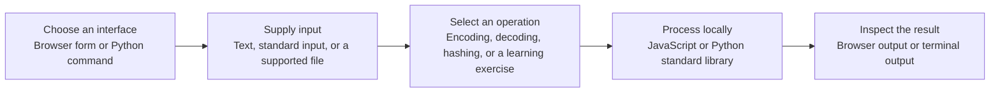

A short string can look familiar and still leave you guessing. Is it text written in hexadecimal, a digest printed in hexadecimal, or a fragment of a larger value? Those possibilities look similar in a text box. The next operation depends on which one you are dealing with. Ghostwire puts the common operations within reach in a browser and in a terminal, with the operation named at the point where you choose it. Its scope is small enough that you can start with a known string, see what happens to it, and check whether you understood the result.

*The hosted interface runs transformations in the browser. The repository also ships a Python CLI.*

## Two interfaces for two kinds of work

In the browser, the toolkit is organized into static pages for encoding and decoding, hashing, classical ciphers, and related utilities. A page gives you a place to paste text or, in the hashing interface, select a file. It is a good fit when you want to compare algorithms or look at one result before choosing the next operation. GitHub Pages serves the interface, and the transformation itself runs in the browser. The hosting server needs to deliver files, while the values entered in the tools stay on the client.

The CLI starts at `ghostwire.py` and puts command dispatch in the Python package. Its encoding, hashing, and text utilities live in separate modules. The README describes a standard-library install, so having a supported Python interpreter is enough to run the command from a checkout. A positional argument works for short examples. Standard input gives the caller a route from a file or a preceding command and makes it easier to repeat a transformation. The choice between interfaces follows the task. A browser form is convenient for a one-off comparison. A pipeline gives the same operation a place in a repeatable local process.

## Where text becomes bytes

The encoding tools include standard Base64, URL-safe Base64, hexadecimal, and percent-encoding. The distinction between the first two is easy to miss if you try them on a string that never produces a character whose alphabet changes. Ghostwire exposes them separately, and the CLI documents URL-safe Base64 output without padding. That explicit choice is useful when a receiving system expects a particular format. It also makes it easier to reason about a result that looks almost identical to the version you expected.

Hashing makes the input representation especially visible. In the browser, text is turned into bytes before the digest is computed. The file path reads the selected file's bytes. A file can contain a final line break even if the text you pasted into the form does not. A digest comparison is only as meaningful as the agreement about both inputs. This is the kind of difference that a repeatable terminal invocation can help pin down. The browser helps on the other side of the same task by placing the selected algorithms and their outputs where you can compare them directly.

The hashing page uses Web Crypto for supported digests and HMAC operations. Its source also includes JavaScript implementations for algorithms outside the browser API it uses, such as SHA3-256. The Python side has its own standard-library implementation choices. That lets each interface work with its runtime, at the cost of having more than one implementation surface. A shared operation name is a useful starting point for comparison. To verify parity for a particular input, you still need to fix the algorithm and bytes and compare the two outputs.

## What a result can tell you

An encoding gives bytes a representation that another system or person can carry around. A hash produces a digest that can be compared against a known value. Ghostwire groups utilities around those jobs because the output of one can easily be mistaken for the output of the other. Looking at a hash-shaped string can narrow down plausible formats, and several algorithms can produce the same printed length. Identifying the algorithm in a real workflow takes context about how the value was generated.

The classical-cipher material serves a different purpose. It gives learners a place to see how substitutions change a message and compare what a chosen transformation does to sample text. The small examples are helpful because the input and result fit on the same screen. They make the mechanics visible and give someone a chance to correct their understanding before moving on to another operation.

## The boundary I care about

Ghostwire brings together small operations where input and output are the point of the tool. Its browser pages operate client-side and its Python commands can run from a checkout. That arrangement avoids a transformation service and keeps the execution path short. Browser delivery still involves loading the page, and the terminal still runs in the caller's own environment. Those details matter when describing what local processing guarantees.

The workflow that best captures the project is mundane in a good way. Start with a sample whose origin you understand, choose the most likely format, and inspect how the output changes. If the operation needs to be repeated, move it into a local pipeline. The useful part is being able to make each choice explicitly and see the result before deciding what it means.
