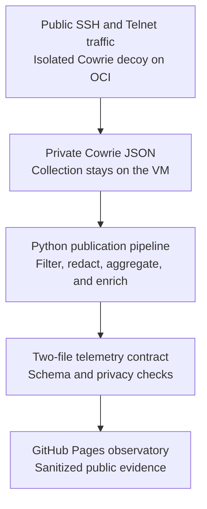

A public SSH service can receive a surprising amount of attention before anyone has a reason to log in. Greyfield starts with that unsolicited traffic and asks what a small defensive sensor can responsibly tell the public about it. Cowrie records activity aimed at an isolated cloud decoy. A separate publication pipeline carries selected, sanitized observations to a static dashboard. The engineering challenge is deciding where those two systems should meet and what evidence can cross that boundary.

*The public observatory visualizes approximate network context from traffic retained by the sensor.*

## Separate the decoy from the way in

Greyfield runs Cowrie on an isolated Oracle Cloud Infrastructure instance. The public SSH and Telnet listeners lead to unprivileged deception services. The real administration service has a separate listener limited to an approved administrator address. This arrangement gives the decoy recognizable services for unsolicited traffic while preserving a distinct management path. The staged runbook calls for verifying that administrative path independently before transferring the public listener to Cowrie. It also treats listener, firewall, persistence, and logging checks as separate gates. A reachable service and a working record of its activity each need their own evidence.

This staging matters because part of the change is happening to the same machine from which the sensor must eventually publish. Losing the management path can interrupt the work before the observation pipeline is ready. Similarly, a successful connection to a decoy only establishes reachability. The collector still needs to record the interaction before the pipeline has anything to review. The architecture makes those dependencies visible without putting the administrative surface in the public dataset.

## Make publication a separate decision

Private Cowrie records and the material a browser can download have very different purposes. The Python pipeline filters non-public and operator sources, redacts sensitive patterns, aggregates retained events, and adds network context. The published data contract has just two files, `metrics.json` and `attack-layer.json`. An outbound-only workflow uses a dedicated orphan telemetry branch as a rolling data channel. The GitHub Pages deployment validates the public files against schema and privacy checks and fails closed if they do not pass.

The branch boundary keeps the rolling dataset distinct from the code without requiring the public site to reach into the VM for raw records. The observatory omits raw logs, session identifiers, TTY recordings, captured files, operator addresses, administrator access details, cloud secrets, and reusable credentials. One reason to review the publication as its own interface is that privacy depends on the complete artifact. A data field may sound harmless in isolation, while the information around it changes what someone could learn from it.

## Read a dot on the globe carefully

The dashboard presents source infrastructure, credential pressure, inert command evidence, and payload retrieval indicators. These are observations at the decoy. A network lookup may add an approximate location for the observed infrastructure. Network context is useful for orienting a reader, but it leaves the identity and physical location of the person behind the traffic unknown. Requests associated with a network can come through infrastructure operated or used by someone else. A globe marker has no way to resolve that distinction on its own.

*Caspar David Friedrich, Wanderer above the Sea of Fog (c. 1818). Public domain, via Wikimedia Commons.*

I chose this plate because the foreground is sharply visible and the distance is harder to read. On the observatory the encounter with the decoy is the foreground. The network label, geographic context, and interpretation come with their own uncertainty. The painting gives that difference a shape the map alone can make easy to overlook.

## Keep technique labels tied to evidence

Greyfield associates selected MITRE ATT&CK techniques with retained observations. An attempted transfer or an observed command at the decoy has a specific evidentiary scope. It leaves execution on another system and the outcome of a wider campaign unknown. Hash-only provider correlation gives the report an option for relating indicators without publishing captured files. The project records attempts as evidence of what reached the sensor and uses those limits when describing the activity.

The data comes from live unsolicited capture on one intentionally discoverable sensor. The vantage point, protocols, and observation period shape what appears in the dashboard. Visibility in internet-wide indexes can confirm exposure, while traffic volume and technique coverage remain contingent on what actually reaches the decoy. Future work could extend the observation history and validate additional sources of enrichment under the same privacy and attribution limits.

[Faultplane](/projects/faultplane) takes a complementary approach to security intelligence by collecting published advisories and enriching vulnerability context. Greyfield follows the path from a private sensor observation to a public record, with the publication boundary determining which parts a reader can inspect.

A reader can start with one dashboard category and ask where its meaning entered the pipeline. A credential pattern describes a submission retained from the decoy. A location label is added from network context. A technique label is an interpretation tied to evidence in the report. Those three fields can appear next to each other in a public view, even though each supports a different kind of claim. Making that distinction visible is part of the publication design and gives a reader a way to inspect the report without access to the private session records.
