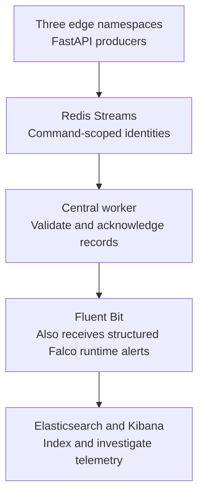

A workload can pass admission and still do something worth investigating. A runtime alert can be accurate and still leave an operator asking where to find it. KubeSentinel puts both questions on the same machine. I built the lab around a local Kubernetes deployment with three logical sites, a shared event path, and controls that can be exercised under repeatable conditions. The point of the exercise is to follow a decision or observation through the cluster and see where the evidence lands.

*The repository view is the entry point to the local lab and its documented validation evidence.*

## Three sites on one node

Pune, Mumbai, and Bangalore are logical edge sites represented by separate namespaces in a single-node k3d cluster. Hardened FastAPI services publish security events to a Redis Stream. A central worker validates the events and acknowledges them through the stream consumer group. It emits processed event JSON that can be picked up with the rest of the telemetry. That gives a reader a path from application activity through a shared service to the place where the resulting records can be investigated.

The three namespaces let the lab exercise boundaries between workloads. They share the single cluster and host, so the evidence concerns logical isolation at that scale. A deployment across physical sites would introduce separate node, connectivity, and failure conditions beyond this setup. Keeping the topology small makes it feasible to repeat a scenario and inspect the artifacts on one machine.

## Put each control where it can act

Pod Security Admission and nine Kyverno policies evaluate workload configuration. RBAC answers which Kubernetes actions a given identity can perform. NetworkPolicies govern permitted communication between workloads. Redis ACLs constrain what authenticated Redis identities can do once they reach the service. The producer, consumer, and bootstrap identities have separate command scopes. This matters because access to a service and permission to perform an operation on it are different checks. The worker's need to read and acknowledge stream entries gives it responsibilities a producer does not share.

The lab documents infrastructure exceptions. Application namespaces use the restricted Pod Security profile. Observability uses baseline, while the pinned Kyverno controller runs in a privileged namespace. Falco's modern eBPF collection requires host access in the security-agents namespace. Keeping those exceptions with the relevant infrastructure makes it possible to discuss what each component needs alongside the restrictions applied to the edge workloads.

*Albrecht Durer, Illustration from Treatise on Fortification (Nuremberg, 1527). CC0, via Wikimedia Commons.*

The fortification drawing interests me as a plan of boundaries. Where should movement be possible, and what protects the places that need it? The cluster has concrete answers at several levels. Admission constrains which workloads enter. Network policy constrains their communications. Stream permissions govern what an identity can do when it arrives at Redis.

## Follow the runtime signal to the analyst

Falco supplies a second telemetry source alongside the structured application data. Fluent Bit routes both types to Elasticsearch, and Kibana makes them searchable. The runtime scenario needs evidence at both ends of this path. A local detection shows that Falco saw the controlled activity. An indexed structured event shows that an investigator can retrieve the resulting signal. Each checkpoint helps locate a failure if the expected record is missing from the final view.

The repository records a tuning exercise that reduced 33 candidates to 25 while retaining all 25 controlled shell events. That result describes a specific set of synthetic events. It gives an example of testing a rule change against known input and checking which events remain visible. Wider detection performance would depend on workloads and activity outside the controlled lab.

## What the recorded run covers

The [validation evidence](https://github.com/dedsec-terminal/KubeSentinel#validation) records five passing controlled scenarios. They cover runtime detection, Redis access control, Kubernetes RBAC, admission policy, and cross-edge isolation. The related integration run recorded 287 passing automated tests, and the supplied README also reports 298 in its checkout snapshot. Those counts describe separate recorded runs. The repository also documents automated CI and security scanning with Trivy, Checkov, Hadolint, and SBOM generation.

What makes those scenarios readable is the variety of decisions they cover. A request to the Kubernetes API exercises an authorization path. A restricted Redis command exercises a separate service permission. A network check tests permitted reachability, and the runtime scenario follows detection into the searchable record. A passing scenario supports the boundary or behavior it exercised on that local setup. The lab uses deterministic, synthetic measurements and provides no evidence of production scale, multi-node resilience, or detection coverage across other environments.

The evidence also offers a way to reason about failures. If an application record never appears in Kibana, the event path gives several concrete places to inspect. The producer has to publish, the worker has to receive and validate the entry, and the resulting record has to reach the index through Fluent Bit. A runtime record begins in a different component and joins the application path at the shipper. That difference matters during investigation. A shared destination can make two sources convenient to search while the reasons for missing evidence remain specific to each source.
