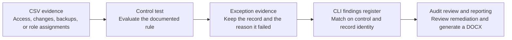

An audit finding often starts with a date that is out of order. A change reaches production before the ticket is approved. A terminated employee's account logs in after the recorded departure. The comparison can be simple. Keeping track of which records were tested, what the exception shows, and who can close it is where the work starts to accumulate. LedgerCast follows that trail from CSV evidence through a repeatable rule and into a findings register. It uses bundled sample data to demonstrate IT general controls testing in a SOX-style audit.

*LedgerCast opens with bundled sample data. The hosted dashboard can evaluate uploaded CSVs in the browser.*

## Each test asks one question of the evidence

The Risk & Control Matrix describes four tests covering access management, change management, backup and recovery, and segregation of duties. Each has a control objective and its own evidence population. The Python package keeps the tests in separate modules. A reviewer can read the procedure for production changes without first unpacking how job timestamps or role assignments are interpreted.

Access management is a good example of the gap between a control and an observable condition. The objective is for terminated employees' access to be revoked by their termination date. The implemented check examines rows marked as terminated and flags a last login after that date. A later login is evidence of an exception. Silence in the login field leaves the auditor with a question about what the export can establish. To confirm timely revocation, a reviewer would need evidence of the revocation event or another record that directly supports it.

The change test asks whether production changes have documented approval before deployment. Backup testing examines scheduled jobs and flags failures or completion outside their expected window. That evidence describes how the backup job ran. A restore exercise would answer the separate question of whether the data can actually be recovered. The segregation-of-duties test checks users' assigned roles against a CSV ruleset. Whoever reviews a conflict can see which pair raised it and inspect how that pair was defined. The ruleset makes the risk assumption visible and editable without burying it inside the CSV-reading logic.

## A clean rerun still leaves a decision

The persistent CLI register lives in `findings_state.json`. LedgerCast identifies an exception by the combination of control and record ID. For segregation of duties, the record identity includes both the user and the rule, so two distinct conflicts for one user can be tracked separately. The finding carries its own ID and fields for status, owner and due date. That gives a reviewer a stable record to update when the same issue appears on a subsequent run.

A finding stays open if its exception disappears from the next result. An input population can change for reasons that have little to do with remediation. Maybe the new export covers a shorter period. Maybe the record was excluded. The tool requires a deliberate status update, which leaves closure with the reviewer who can check what happened and inspect supporting evidence. The cost is a bit of follow-up work. The benefit is keeping the history of the finding intact across changing inputs.

*Jacopo de' Barbari, Portrait of Fra Luca Pacioli (c. 1495). Public domain, via Wikimedia Commons.*

## One workflow for exploration, another for recurring work

The static dashboard starts with sample data and shows the findings register beside the framework mappings. A reviewer can upload a CSV on a control card to try the rule with another population. Processing happens client-side. For repeated work, the CLI runs the Python tests, manages the persistent findings and produces a DOCX audit report. The browser makes it easy to inspect a control quickly. The CLI gives repeat runs a durable place to keep the records they share.

The browser and Python implementation are separate surfaces. The ability to upload evidence on the dashboard is useful on its own, but a recurring audit also needs decisions about which exports are retained, how they were obtained and what population they represent. A local JSON register keeps the demonstration easy to inspect. A team using the workflow across several reviewers would need to decide how it governs access, changes and evidence retention.

The schemas are part of the audit procedure, too. The repository documents the CSVs the tests expect, so swapping in a new export begins with checking how its columns correspond to the test's evidence fields. A date with a different meaning can produce a plausible-looking result while answering the wrong question.

## How the mappings support review

The project relates its controls to ITGC/SOX, ISO 27001, NIST CSF 2.0 and COBIT 2019. Mapping a result helps someone locate a common control objective across those references. The substance of the result still comes from the test and the supplied evidence. If a report says that a change was deployed before approval, the record and timestamps carry the claim. The framework tag tells the reader where to trace it.

That division is what makes the project useful as a demonstration. A rule can find the exception, the register can keep it visible, and the report can present it with context. The reviewer still determines whether the evidence is sufficient and whether remediation warrants closure. The work is easier to follow because each decision has a place to land.
