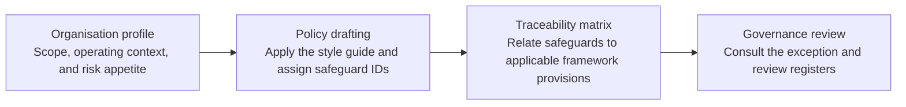

A security policy begins to earn its place when somebody has to use it. Imagine a team at FinNexus Solutions preparing to put a data set into a test environment. They need to know how it is classified, which handling requirements apply, and who can decide what happens if the ordinary rule cannot be met. A paragraph that says to protect sensitive information leaves all three questions open. PolicyForge works through those questions as a governance programme for a fictional fintech organisation. The result is a set of documents you can navigate from a business assumption to an individual safeguard and then into the records that support oversight.

*The published viewer presents the policies alongside the organisation context, framework mapping, and governance registers.*

## The organisation profile comes before the rules

The profile sets the operating context, scope and risk appetite for FinNexus. It gives policy authors a shared reference when they decide where a requirement belongs and which role should own it. A document can sound reasonable in isolation while making assumptions that another department cannot meet. The profile gives a reviewer a way to see which organisation the policies were written for and what assumptions carry across them.

The repository contains eight policies covering acceptable use, access management, asset management, business continuity and backup, data classification and handling, incident response, password and authentication, and vendor and third-party risk. A drafting guide gives them a common order, from document-control metadata and scope through safeguards, responsibilities, enforcement, review cadence and revision history. There is room for a policy-specific taxonomy when it helps explain a domain. The data classification policy uses that space to lay out handling tiers before going into individual requirements.

## A safeguard needs a stable address

The style guide assigns each safeguard a short prefix and sequence number. In the data classification policy, `DC-01` covers mandatory classification, `DC-02` covers labelling, and `DC-09` addresses data in development and test environments. A recurring question about test data has a direct reference somebody can cite in a review. That reference can survive a wording revision and gives related policy documents a precise target when they refer back to the safeguard.

The drafting guide calls for normative verbs and explicit mechanisms, timeframes, evidence or standards where they matter. A requirement that uses `MUST` gives a reader a different decision from one that uses `SHOULD` or `MAY`. Giving the verb a named role and an action makes the document easier to review. It gives somebody a place to ask whether the action is feasible and what an implementation would have to show.

*Joseph Wright of Derby, An Experiment on a Bird in an Air Pump (1768). Public domain, via Wikimedia Commons.*

## Traceability leaves a trail for the reviewer

The control traceability matrix connects safeguards to applicable references from ISO/IEC 27001:2022, NIST CSF 2.0, PCI DSS v4.0.1, India's Digital Personal Data Protection Act, 2023, and the GDPR. It gives somebody reading a framework reference a way back to the relevant policy text. The repository includes a matrix audit report, so the mapping itself has a review surface. A reference in the matrix establishes the relationship being claimed. Evaluating whether the safeguard meets an organisation's obligations still depends on applicability, interpretation, and evidence from operation.

There is a maintenance cost in presenting relationships in the policy and in a matrix. A safeguard revision can leave its second appearance behind. Keeping both in source control makes changes reviewable alongside each other. PolicyForge includes scripts for matrix validation and coverage analysis. Those checks address the consistency and coverage of the artefacts. Assessing whether a mapping makes sense still requires reading the control and the provision it cites.

The exception log and review cadence tracker carry the programme beyond a document's first draft. An exception record helps a reviewer understand the decision behind a deviation, and the review tracker makes it possible to see when the requirement is due for another look. Those records illustrate how the lifecycle would work. The document status and date placeholders keep the examples clearly in draft. They also preserve a step that would matter in an adopting organisation, where a policy owner needs an actual review and approval process before assigning effective dates.

A review date and an exception serve different purposes. A scheduled review asks whether the requirement still fits the business. An exception records a decision about a particular deviation under the current requirement. A reader can consult both records without having to infer a policy change from an exception entry.

## The viewer follows the source documents

The canonical policy and governance Markdown lives outside `docs/`. GitHub Actions assembles the Pages deployment from those documents and a hand-authored viewer. The generated document copies are build output. A policy edit therefore has a clear home, and a reviewer can inspect the source change independently of how the site presents it.

What I like about this structure is that a reader can enter from either end. Start with a test-data question and follow the safeguard out to its framework mapping, or start with a framework citation and walk back to the policy that expresses it. Adoption would require accountable owners, organisation-specific review and actual evidence. The repository demonstrates the documents and relationships that make that review possible.
