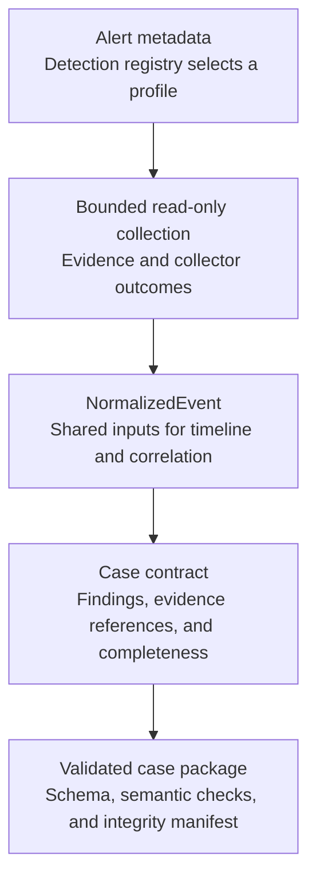

A security alert gives an investigator a place to start. The work that follows is harder to reconstruct. Which process was observed? Was a network event associated with it? Which source recorded the relationship, and could another analyst find the same record? I built TraceIR as a final-year engineering project to make those questions part of the workflow. It takes alert context into a bounded investigation and packages the evidence, timeline, and findings in a case another reader can review.

*The public explorer presents generated cases and their evidence limits.*

## Decide what to collect

The detection registry reads metadata from the repository's Sigma material and uses it for routing. TraceIR leaves rule execution to other tooling. The selected investigation profile defines the collection plan, and read-only collectors supply evidence within that plan. The repository includes synthetic collection and parsers for exported Windows Sysmon and Linux osquery or auditd data where implemented. That scope matters when interpreting output from different endpoints. A profile defines evidence to look for, while each collector's result tells the analyst what was actually available.

A collection plan also establishes the boundary for interpreting silence. If network telemetry was unavailable, the analyst has an explicit reason the case cannot answer some network questions. If a source was outside the profile, the absence of its records says something about the investigation scope. Those cases carry different implications for follow-up.

## Give the timeline and findings a common input

TraceIR uses a canonical `NormalizedEvent` representation for timeline reconstruction and correlation. The evidence still has provenance. Having both consumers work from a common representation gives the timeline and finding a common basis for referring to the underlying event. The timeline is deterministic and keeps explicitly untimed evidence visible. Giving an untimed record a plausible position would make a cleaner chronology and introduce an assumption into it. Keeping it separate leaves the analyst free to question its relationship to surrounding events.

The case distinguishes observed, derived, enriched, and inferred material. An observed record and a process/network relationship derived from records answer different questions. The first describes what the source contains. The second describes a connection the workflow made. TraceIR includes evidence references and limitations alongside the relationship so a reviewer can inspect how far the inputs support it.

*Johannes Vermeer, The Geographer (1669). Public domain, via Wikimedia Commons.*

The geographer has the instruments and the chart on the table, but the painting catches him looking away from both. That pause is what interested me. A timeline gives the analyst a way to orient themselves, and the references let them stop at a claim and look back at the source.

## Preserve the gaps in the case

The explorer contains four deterministic, sanitized synthetic investigations. The PowerShell case shows a process/network relationship in a wider set of process, event-log, network, file, persistence, and session evidence. The authentication case shows repeated failed logons followed by a success. That sequence is observable in the example, while credential compromise remains unestablished. The persistence case shows scheduled-task telemetry as a data-only indicator, with no persistence action carried out on an endpoint. The incomplete case makes missing visibility part of the investigation itself.

TraceIR records `COMPLETE`, `PARTIAL`, `ERROR`, `UNAVAILABLE`, and `NOT_REQUESTED` as distinct states. Those labels make it possible to see where a collector returned some evidence, where it failed, and where the plan never called for a source. The synthetic cases are generated from repository fixtures. They demonstrate how the system expresses these limits and provide reproducible examples for the reader.

## Make the exported package checkable

JSON Schema checks the shape of a case. Semantic validation checks relationships across its documents. SHA-256 file manifests and a bundle digest give the recipient a way to check whether the package matches its recorded integrity data. Optional HMAC-SHA256 authentication adds a keyed check through a sidecar. Artifact provenance, append-only custody records, and privacy-aware redaction also belong to the case workflow. SQLite provides a derived index for convenient lookup, with the manifest-backed package remaining the authoritative case artifact.

Each measure answers a specific question about the package. File integrity helps a reviewer detect changes to the export. It cannot establish whether an endpoint source captured everything that happened, or whether an inference deserves a stronger conclusion. The public demo shows the case contract using synthetic evidence and makes no claim about production investigation coverage.

For a separate example of reasoning from a security alert with explicit evidence limits, read [From Alert to Timeline](/writeups/from-alert-to-timeline). It follows a worked investigation and gives another view of where an analyst stops, records uncertainty, and reaches for the next source.

A useful way to read the explorer is to open the incomplete case before the PowerShell case. Start with the collection outcomes and ask which timeline questions those sources could plausibly answer. Then move to a case with a derived relationship and follow its evidence references back to the normalized records. The same layout supports both tasks. With more complete inputs, it helps explain where a finding came from. With missing inputs, it gives the analyst a place to record the limits and identify which source would be worth obtaining next.
