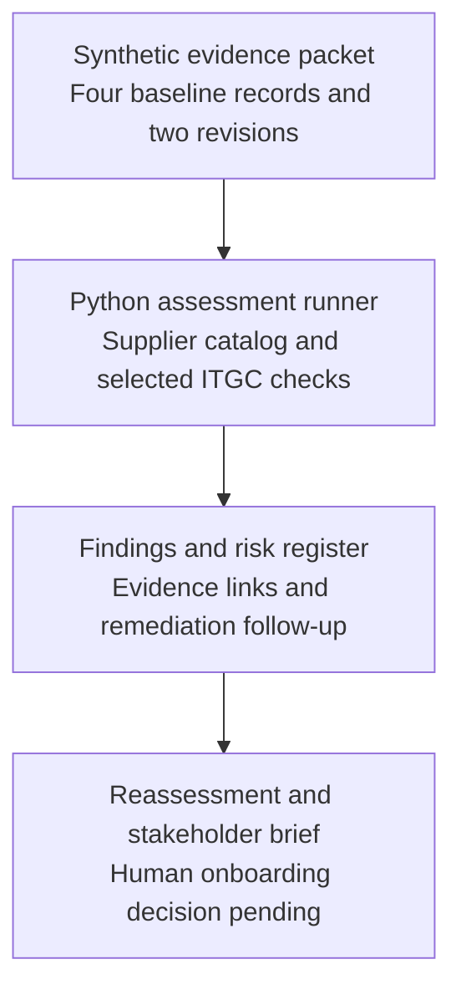

A payroll supplier sends a certificate, an assurance summary, and a letter. The packet looks complete until someone asks which service the documents cover, when the controls were examined, and what the customer still has to do. Vendor Assurance Desk turns that moment into a worked third-party risk review. HarborPay Demo is the fictional supplier. The case follows an assessment from the initial evidence packet through reassessment and a documented recommendation.

*The public dashboard is a read-only view of the worked HarborPay case.*

## Read what each document actually supports

The synthetic packet includes ISO certificate claims, a SOC 2 Type II-style summary, a management bridge-letter scenario, a policy summary, and a customer MFA responsibility. The due-diligence review tracks scope, period, opinion, exceptions, subservice organizations, and unresolved questions. Those dimensions matter because one document can answer a question about a management system while leaving another about the payroll service open. A period end date also tells the reviewer where the assurance stops and where follow-up begins.

A bridge letter can tell the reviewer what management says about the intervening period. The original independent assurance still has its own period and scope. Similarly, a customer MFA obligation gives the organization considering HarborPay a task of its own. The supplier's evidence and the customer's responsibility both belong in the review, with follow-up assigned to the party that can act on it.

*Rembrandt, The Syndics of the Drapers' Guild (1662). Public domain, via Wikimedia Commons.*

I chose the painting for the moment when the figures look up from the table. A review has that change of audience built in. One person assembles the file, but another person must be able to pick it up, find the exception, and see why the recommendation follows.

## From evidence packet to decision brief

The standalone Python runner evaluates the synthetic case against selected assurance and IT general controls checks. A ten-question supplier-control catalog links the review to evidence, requested follow-up, and accountable roles. Selected NIST CSF 2.0 outcomes and ISO/IEC 27001:2022 Annex A controls give those questions a reference point. The worked review makes room for the context a selected check cannot settle, including what evidence would be acceptable before onboarding.

The case has two surfaces. The public GitHub Pages viewer presents the assessment and supporting documents. A separate authenticated CISO Assistant Community setup runs locally in Docker on Ubuntu under WSL2, with a supplier, payroll service, assessment, and ten control records. The repository records an authenticated browser check confirming that HarborPay Demo appears in the Entities view. The standalone assessment and viewer run with Python 3.10 or newer and require no pip packages. That gives a reader a way to reproduce the worked case without bringing up the full GRC platform.

## Keep the historical exceptions visible

The scorecard is easiest to understand by following the original and revised evidence together. The repo records three flagged assurance gaps across four baseline records and one across the same four checks after revision. The selected ITGC checks detected three seeded exceptions, and the clean comparison rows were left unflagged. The record retains both historical access and change exceptions during retesting. That distinction matters when the next reviewer needs to understand what happened during the period under review and what the revised evidence now supports.

Those are measurements of the synthetic case. They show that the selected checks distinguished the seeded examples under the recorded conditions. They supply no estimate of production accuracy or actual reduction in supplier risk. The repository also records regression tests and browser checks across all six dashboard views and the document reader. These checks cover the tooling and presentation. The evidence sufficiency decision still belongs to a reviewer.

## Leave the decision with its owner

The stakeholder brief compares approval, conditional onboarding, and a hold. The worked recommendation is a hold pending current independent assurance or a reviewer-validated alternative proportionate to the service, along with customer controls, contract, and continuity review. The alternative matters because a reviewer needs to judge whether the combination of available records answers the open questions at the right level. Merely collecting a larger packet would leave those questions intact.

The local assessment remains `in_review` and its controls remain `to_do`. A presentation outline and feedback record are available, while an actual peer presentation and feedback remain pending. No human onboarding decision has been made. The [worked due-diligence case](https://dedsec-terminal.github.io/Vendor-Assurance-Desk/site/review/) is the best place to trace the recommendation from the source packet to its current state. It shows how the onboarding question can stay open even when a reassessment resolves several of the gaps that started it.

A reviewer can also work backward from one open item in the brief. Start with the decision it affects, identify the catalog question, and then find the assurance record or customer responsibility that bears on it. If the evidence is a revision, read it alongside the earlier record and inspect what actually changed. That route through the project explains why the dashboard's count is only a starting point. The due-diligence file holds the context needed to tell whether a gap was closed by newer evidence, whether an exception still belongs in the historical record, and who has to act next.
