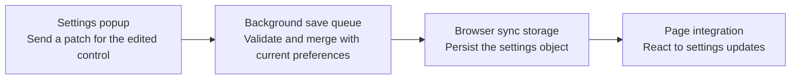

I wanted a YouTube video to take up the browser window and leave the window itself where I had put it. That distinction matters when YouTube sits alongside another app or when I want to scroll down the watch page and come back to the video. The port begins with two extensions that already did separate pieces of what I wanted. [YouTube Inline Fullscreen](https://github.com/doubleyoustew/youtube-inline-fullscreen) supplied the player layout and scrolling behaviour. [YouTube NonStop](https://github.com/lawfx/YoutubeNonStop) supplied the playback continuation behaviour. Combining them made the interaction between their settings, browser lifecycles, and packaging my part of the problem.

*The Firefox Add-ons listing is the signed distribution channel. The Chrome build is distributed separately through GitHub releases for loading unpacked.*

## The fullscreen implementation already did the hard part

The original inline fullscreen code sets up a player that fills the browser window and retains the original scrolling behaviour. Its layout and page interaction are vendored in the extension. Keeping that upstream behaviour was an intentional boundary for the port. I could make the features coexist and give them a common settings surface without introducing my own viewport rules and another set of assumptions about YouTube's layout.

On a watch page, the extension can activate inline fullscreen automatically. The default shortcut is D, with Escape to exit. The popup lets the user show or hide the player button, edit or disable the shortcut, or change the automatic behaviour. That brings the most common controls together while keeping the shortcuts familiar to someone who already uses the upstream extension.

NonStop covers a different problem. It attempts to suppress idle playback interruptions on YouTube and YouTube Music. Inline fullscreen targets YouTube watch pages. The settings make the two behaviours independently selectable, so a person who wants the layout can decide separately whether to enable playback continuation. The repository describes the feature in terms of its idle-prompt behaviour. A dropped connection or a future site change has its own failure modes.

## The popup can disappear before the save does

An extension popup has a brief lifetime. Imagine opening it, changing two checkboxes, then clicking back into the video. If both changes are implemented as independent reads and writes of a single settings object, they can read the same starting state. The second write can then carry a stale copy of the field changed by the first. Closing the popup also means its UI is no longer available to finish the job or display the outcome.

The port sends a patch to the extension background context and queues saves there. Each queued save reads the current sync settings at its turn, validates the incoming fields, merges the patch with the saved state and defaults, and writes the result. A failed save can return an error and later saves still get their turn. Serializing the read, merge, and write does add an ordering point, but the work is bounded to a small preferences object. That is a good trade when quick edits to independent controls should both survive.

There is also a boundary between extension storage and the page-side NonStop logic. The bridge reads the current preference and listens for updates in sync storage. It sends the enabled state to the page via a custom event and answers the page's readiness event. Both sides can therefore start in either order and still have a way to exchange that setting. Browser storage holds the preferences and can sync them through the browser account. The port adds no analytics code.

## Two packages share one build

The build takes the vendored inputs and the port's JavaScript and CSS and produces separate Chrome and Firefox directories and release artifacts. It uses esbuild to minify the runtime assets. The source bundle includes the vendored code, licenses, the package lock, and the build script so the Firefox submission has the material needed to reproduce the package. That leaves browser-specific distribution at the packaging boundary while making the source used by the two builds easier to follow.

The signed version 1.5.0 is available from Firefox Add-ons. The corresponding [Chrome package](https://github.com/dedsec-terminal/youtube-window-theater/releases/tag/chrome-v1.5.0) can be loaded unpacked. An [unsigned Firefox package](https://github.com/dedsec-terminal/youtube-window-theater/releases/tag/firefox-v1.5.0) is available for temporary testing. Those are different installation paths for artifacts from the same port.

The separate install paths also affect reproduction. The repository documents loading a local Firefox build temporarily through the browser's debugging page. That keeps a development build distinguishable from the signed release someone would install for everyday use.

## The regression that matters happens between clicks

The repository's Playwright suite drives an isolated Chromium profile against a public YouTube video. It exercises repeated popup reopening, concurrent changes, settings persistence after closing, shortcut editing, automatic fullscreen, and the NonStop toggle. Reopening the popup is useful because the next instance has to show the state that survived the previous one. Inspecting the checkbox immediately after clicking it would only tell you what that instance was displaying.

Firefox validation documented in the repository is static. The Chromium browser tests cover the runtime scenarios above. That distinction matters when describing a port that has two installable packages. For me, the test that captures the engineering work is the small sequence of changing a setting and immediately leaving the popup. It proves something about where the save lives, and that is precisely the bit I needed the port to own.
