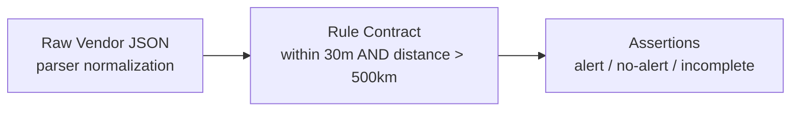

Synthetic regression tests make a detection rule's expected behavior explicit before a change reaches production. The scenario below is fictional: the accounts, locations, and events are examples, not a real investigation or personal experience.

The rule under test is an impossible-travel alert. It compares pairs of successful sign-ins for one account. If two sign-ins occur within thirty minutes and their locations are more than five hundred kilometers apart, it creates an alert. A recent change replaced the event parser, so the team needs to confirm that the alert still fires for the intended case, stays quiet for ordinary movement, and handles incomplete records without crashing.

The first sign that the parser changed anything might be a quieter alert queue. That looks like good news until someone asks how many sign-ins actually made it to the distance calculation. A clean rule test can sit beside a broken feed for weeks because its fixtures enter the pipeline at exactly the point where the parser has already done its work.

## Three cases


*Joan Blaeu, Nova et Accuratissima Totius Terrarum Orbis Tabula (1664). Public domain, via Wikimedia Commons.*

The test set contains one positive case, one negative case, and one missing-field case.



- **Positive:** `demo-user-17` signs in from `Hudson, NY` at 09:12 UTC and from `London, UK` at 09:24 UTC. The twelve-minute gap and long distance should produce one alert.
- **Negative:** the same account signs in from `Hudson, NY` at 10:03 UTC and again at 10:07 UTC. Same location and a short gap should produce no alert.
- **Missing field:** a second sign-in record arrives with a valid account and timestamp but no latitude or longitude. The rule should record the event as incomplete, skip the distance calculation, and create no alert.

The missing-field case matters as much as the other two. A parser that assumes every event has coordinates can throw, skip the whole batch, or treat a missing value as zero. Each outcome is worse than a clearly labeled incomplete record.

## A small harness

The tests below express the rule as a pure function so that the input and expected output are visible in one place.

```python
from dataclasses import dataclass
from datetime import datetime
from math import asin, cos, isfinite, radians, sin, sqrt


@dataclass
class SignIn:
    account: str
    timestamp: str
    latitude: float | None = None
    longitude: float | None = None


def evaluate(pair: tuple[SignIn, SignIn]) -> str:
    first, second = pair
    if first.account != second.account:
        return "no-alert"
    if first.latitude is None or first.longitude is None:
        return "incomplete"
    if second.latitude is None or second.longitude is None:
        return "incomplete"
    coordinates = (first.latitude, first.longitude, second.latitude, second.longitude)
    if any(not isfinite(value) for value in coordinates):
        return "incomplete"
    if any(abs(value) > limit for value, limit in zip(coordinates, (90, 180, 90, 180))):
        return "incomplete"
    try:
        start, end = (datetime.fromisoformat(event.timestamp) for event in pair)
    except ValueError:
        return "incomplete"
    if start.utcoffset() is None or end.utcoffset() is None or end < start:
        return "incomplete"
    if (end - start).total_seconds() > 30 * 60:
        return "no-alert"
    lat1, lon1, lat2, lon2 = map(radians, coordinates)
    a = sin((lat2 - lat1) / 2) ** 2
    a += cos(lat1) * cos(lat2) * sin((lon2 - lon1) / 2) ** 2
    distance_km = 2 * 6371 * asin(sqrt(min(1, a)))
    if distance_km > 500:
        return "alert"
    return "no-alert"


def test_positive_case():
    first = SignIn("demo-user-17", "2026-11-22T09:12:00Z", 42.25, -73.79)
    second = SignIn("demo-user-17", "2026-11-22T09:24:00Z", 51.51, -0.13)
    assert evaluate((first, second)) == "alert"


def test_negative_case():
    first = SignIn("demo-user-17", "2026-11-22T10:03:00Z", 42.25, -73.79)
    second = SignIn("demo-user-17", "2026-11-22T10:07:00Z", 42.25, -73.79)
    assert evaluate((first, second)) == "no-alert"


def test_missing_field_case():
    first = SignIn("demo-user-17", "2026-11-22T11:00:00Z", 42.25, -73.79)
    second = SignIn("demo-user-17", "2026-11-22T11:05:00Z")
    assert evaluate((first, second)) == "incomplete"
```

The harness expects Python 3.11 or later and receives pairs of successful sign-ins. The caller owns ordering. An event delivered late can arrive behind an event with a later source timestamp. If that pair reaches the function in arrival order, the rule returns `"incomplete"`. A caller with a reordering buffer can test that behavior separately by releasing a pair in timestamp order once both events are available.

## The fixture that starts one step earlier

A parser refactor can swap the two coordinates without changing their types. Hudson's longitude even fits inside the valid latitude range. The same is true of both London values. Run the adapter against JSON strings in which the keys appear in different orders, then assert the field assignments before checking the verdict. This is a small stand-in for a vendor contract. In a service, call the actual adapter at this boundary.

```python
import json
from dataclasses import replace
from unittest.mock import patch


def parse_vendor_event(raw: str) -> SignIn:
    event = json.loads(raw)
    location = event.get("location") or {}
    return SignIn(
        account=event["user"],
        timestamp=event["occurred_at"],
        latitude=location.get("latitude"),
        longitude=location.get("longitude"),
    )


def test_adapter():
    first = parse_vendor_event(
        '{"user":"demo-user-17","occurred_at":"2026-11-22T09:12:00Z",'
        '"location":{"longitude":-73.79,"latitude":42.25}}'
    )
    second = parse_vendor_event(
        '{"user":"demo-user-17","occurred_at":"2026-11-22T09:24:00Z",'
        '"location":{"latitude":51.51,"longitude":-0.13}}'
    )
    assert (first.latitude, first.longitude) == (42.25, -73.79)
    assert (second.latitude, second.longitude) == (51.51, -0.13)
    assert evaluate((first, second)) == "alert"
    swapped = tuple(
        replace(event, latitude=event.longitude, longitude=event.latitude)
        for event in (first, second)
    )
    assert evaluate(swapped) == "alert"

    partial = parse_vendor_event(
        '{"user":"demo-user-17","occurred_at":"2026-11-22T09:24:00Z",'
        '"location":{"latitude":51.51}}'
    )
    assert partial.longitude is None
    assert evaluate((first, partial)) == "incomplete"


def test_boundaries():
    first = SignIn("demo-user-17", "2026-11-22T09:12:00Z", 42.25, -73.79)
    at_limit = SignIn("demo-user-17", "2026-11-22T09:42:00Z", 51.51, -0.13)
    late = replace(at_limit, timestamp="2026-11-22T09:42:01Z")
    assert evaluate((first, at_limit)) == "alert"
    assert evaluate((first, late)) == "no-alert"
    assert evaluate((at_limit, first)) == "incomplete"

    with patch.dict(evaluate.__globals__, asin=lambda _: 500.0 / 12742):
        assert evaluate((first, at_limit)) == "no-alert"
    with patch.dict(evaluate.__globals__, asin=lambda _: 500.01 / 12742):
        assert evaluate((first, at_limit)) == "alert"
```

Those last assertions in the adapter test tell two different stories. Both the real pair and the swapped pair produce an alert because both distances still exceed the cutoff. A positive test over raw JSON that asserts only the alert would miss the regression too. Asserting both coordinates makes the contract observable before the rule collapses the evidence into three possible verdicts.

The time boundary gets a matched pair of controls. The second sign-in moves by one second, with account and location unchanged. Exactly thirty minutes qualifies under `<= 30 * 60`. One second later the pair is outside the rule's window. Reversing the exact-boundary pair exercises a different decision, since a negative interval is incomplete and cannot be treated as eligible under the upper bound alone.

The distance test replaces the angle calculation with a controlled value so the existing evaluator receives a computed distance of exactly `500.0` km. It then moves just above the cutoff and requires an alert. A guessed coordinate pair near the cutoff would couple the threshold test to floating-point rounding and the chosen Earth radius. Here the geographic fixtures still exercise the actual distance calculation, and the controlled values exercise the comparison.

## Count what never reached the rule

A missing longitude can survive adaptation as `None` and produce an incomplete pair. A parser exception can remove the whole event before the correlator ever sees it. Both failures can leave the alert count unchanged. Only the first produces an incomplete verdict, so a dashboard that counts verdicts alone can show a healthy rule while input coverage falls.

Track accepted and rejected records at the adapter, missing-coordinate events by source, and incomplete pairs at evaluation. Give each counter a defined denominator. Two raw records produce at most one pair in this fixture, while a live correlator might reuse one event across several comparisons. Check that the partial fixture increments the missing-coordinate counter and reaches evaluation, alongside a malformed JSON fixture that increments the parser rejection counter. Use source and a bounded reason label for metrics, with event identifiers kept in controlled logs when investigation requires them.

## What these tests establish

The tests establish that the rule's decision logic behaves as documented for three representative inputs. They do not establish that production events are complete, that location data is accurate, or that the alert is useful to analysts. A rule that passes all three cases can still miss a sign-in because the source did not send it, or create noise because a VPN exit node moved.

Record the test version, sample data, and expected results with the rule change. Re-run the suite after any parser, schema, or threshold change. For broader detection and incident-handling context, see [NIST SP 800-61 Rev. 3](https://csrc.nist.gov/pubs/sp/800/61/r3/final) and [From Alert to Timeline](/writeups/from-alert-to-timeline) for an example of working back from an alert to primary records.
