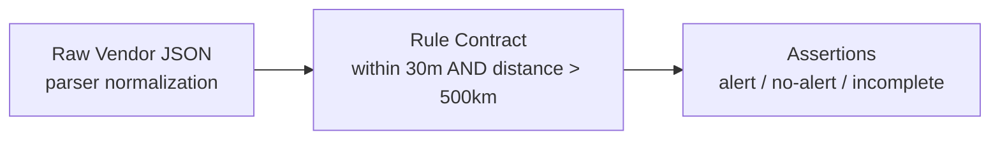

Synthetic regression tests make a detection rule's expected behavior explicit before a change reaches production. The scenario below is fictional: the accounts, locations, and events are examples, not a real investigation or personal experience.

The rule under test is an impossible-travel alert. It compares pairs of successful sign-ins for one account. If two sign-ins occur within thirty minutes and their locations are more than five hundred kilometers apart, it creates an alert. A recent change replaced the event parser, so the team needs to confirm that the alert still fires for the intended case, stays quiet for ordinary movement, and handles incomplete records without crashing.

## Three cases

The test set contains one positive case, one negative case, and one missing-field case.



- **Positive:** `demo-user-17` signs in from `Hudson, NY` at 09:12 UTC and from `London, UK` at 09:24 UTC. The twelve-minute gap and long distance should produce one alert.
- **Negative:** the same account signs in from `Hudson, NY` at 10:03 UTC and again at 10:07 UTC. Same location and a short gap should produce no alert.
- **Missing field:** a second sign-in record arrives with a valid account and timestamp but no latitude or longitude. The rule should record the event as incomplete, skip the distance calculation, and create no alert.

The missing-field case matters as much as the other two. A parser that assumes every event has coordinates can throw, skip the whole batch, or treat a missing value as zero. Each outcome is worse than a clearly labeled incomplete record.

## A small harness

The tests below express the rule as a pure function so that the input and expected output are visible in one place.

```python
from dataclasses import dataclass
from datetime import datetime
from math import asin, cos, isfinite, radians, sin, sqrt


@dataclass
class SignIn:
    account: str
    timestamp: str
    latitude: float | None = None
    longitude: float | None = None


def evaluate(pair: tuple[SignIn, SignIn]) -> str:
    first, second = pair
    if first.account != second.account:
        return "no-alert"
    if first.latitude is None or first.longitude is None:
        return "incomplete"
    if second.latitude is None or second.longitude is None:
        return "incomplete"
    coordinates = (first.latitude, first.longitude, second.latitude, second.longitude)
    if any(not isfinite(value) for value in coordinates):
        return "incomplete"
    if any(abs(value) > limit for value, limit in zip(coordinates, (90, 180, 90, 180))):
        return "incomplete"
    try:
        start, end = (datetime.fromisoformat(event.timestamp) for event in pair)
    except ValueError:
        return "incomplete"
    if start.utcoffset() is None or end.utcoffset() is None or end < start:
        return "incomplete"
    if (end - start).total_seconds() > 30 * 60:
        return "no-alert"
    lat1, lon1, lat2, lon2 = map(radians, coordinates)
    a = sin((lat2 - lat1) / 2) ** 2
    a += cos(lat1) * cos(lat2) * sin((lon2 - lon1) / 2) ** 2
    distance_km = 2 * 6371 * asin(sqrt(min(1, a)))
    if distance_km > 500:
        return "alert"
    return "no-alert"


def test_positive_case():
    first = SignIn("demo-user-17", "2026-11-22T09:12:00Z", 42.25, -73.79)
    second = SignIn("demo-user-17", "2026-11-22T09:24:00Z", 51.51, -0.13)
    assert evaluate((first, second)) == "alert"


def test_negative_case():
    first = SignIn("demo-user-17", "2026-11-22T10:03:00Z", 42.25, -73.79)
    second = SignIn("demo-user-17", "2026-11-22T10:07:00Z", 42.25, -73.79)
    assert evaluate((first, second)) == "no-alert"


def test_missing_field_case():
    first = SignIn("demo-user-17", "2026-11-22T11:00:00Z", 42.25, -73.79)
    second = SignIn("demo-user-17", "2026-11-22T11:05:00Z")
    assert evaluate((first, second)) == "incomplete"
```

This harness expects Python 3.11 or later and pairs of successful sign-ins already sorted by time. Feed at least one raw vendor JSON pair through the production parser before calling `evaluate`—pre-typed dataclass fixtures can all pass while the parser silently swaps `latitude` and `longitude`. Pin the exact boundaries explicitly too: a 30-minute delta (`<= 30 * 60`) still qualifies, exactly `500.0` km does not trigger (`distance_km > 500`), and reversed event order (`end < start`) must return `"incomplete"`. Keep incomplete events visible in a data-quality metric so a parser regression cannot quietly erode alert coverage.

## What these tests establish

The tests establish that the rule's decision logic behaves as documented for three representative inputs. They do not establish that production events are complete, that location data is accurate, or that the alert is useful to analysts. A rule that passes all three cases can still miss a sign-in because the source did not send it, or create noise because a VPN exit node moved.

Record the test version, sample data, and expected results with the rule change. Re-run the suite after any parser, schema, or threshold change. For broader detection and incident-handling context, see [NIST SP 800-61 Rev. 3](https://csrc.nist.gov/pubs/sp/800/61/r3/final) and [From Alert to Timeline](/writeups/from-alert-to-timeline) for an example of working back from an alert to primary records.
