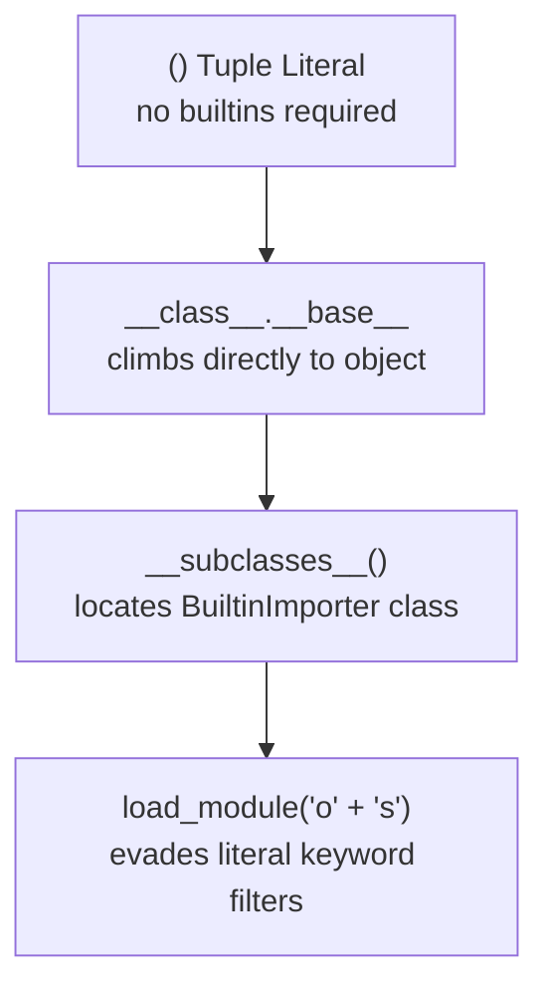

## What this example establishes

Removing builtins from an `eval` namespace does not remove Python's object model. That observation alone does **not** prove that a particular input filter can be bypassed. This note is a conceptual study, not a reproduced challenge solution.

Consider this restricted evaluator:

```python
restricted_env = {"__builtins__": None}
blocked = ["import", "os", "sys", "eval", "exec", "open", "read", "system", "_"]
expression = input().strip()
if any(token in expression for token in blocked):
    raise ValueError("Rejected: forbidden token detected.")
eval(expression, restricted_env)
```

This is a substring filter, not an AST validator. It rejects every expression containing a literal underscore before evaluation begins.


Wait: what if a sandbox drops `_` from its blocklist and only bans keywords like `["import", "os", "sys", "eval", "exec", "open", "system"]` alongside `"__builtins__": None`? Because literal tuples and `object.__subclasses__()` stay reachable without builtins, string concatenation bypasses the word check cleanly (verified locally on Python 3.14):

```python
[c for c in ().__class__.__base__.__subclasses__() if c.__name__ == "BuiltinImporter"][0]().load_module("o" + "s").name
# Returns: 'nt' (or 'posix') with __builtins__ = None
```



## Object traversal has prerequisites

In an unrestricted interpreter, `().__class__.__base__` reaches `object`; `object.__subclasses__()` lists its currently loaded direct subclasses. The set and order depend on the process and its imports, so a hard-coded subclass index is not portable evidence.

The traversal above is rejected by the supplied filter. Likewise, `bytes([95]).decode()` is not a usable workaround here: `bytes` is a builtin name, and this evaluator has removed builtin lookup. Constructing a string containing an underscore would still leave another problem: resolving an attribute through that string requires an accessible attribute-resolution primitive.

Recovering module globals from a loaded class also depends on which classes exist and which implementation exposes useful globals. Neither the presence of a class nor an execution path follows merely from reaching `object`.

## Evidence required for a bypass claim

A reproducible solution would need the exact evaluator, Python version and imports; an input that passes the filter unchanged; and a complete demonstration of attribute resolution, capability recovery, and the claimed result. This note supplies no such accepted input, so it makes no successful escape claim against this harness.

## Defensive design

Avoid evaluating untrusted expressions as general-purpose Python. If a product needs arithmetic, parse an explicit allowlisted AST grammar with resource bounds and test three observable cases before shipping: an allowed expression returns the computed result (`2 + 2 -> 4`), disallowed attribute access (`(1).__class__`) raises immediately before eval, and an over-budget input (`9 ** 9 ** 9`) aborts inside CPU/recursion limits. Changing one namespace dictionary is not a sandbox.

For a related cryptographic boundary discussion, see [the padding-oracle walkthrough](/writeups/padding-boundary-oracle). For defensive investigation examples, explore [TraceIR](/projects/traceir).

## References

- [Python documentation: eval](https://docs.python.org/3/library/functions.html#eval)
- [Python documentation: the data model](https://docs.python.org/3/reference/datamodel.html)
- [Ned Batchelder: Eval really is dangerous](https://nedbatchelder.com/blog/201206/eval_really_is_dangerous.html)
