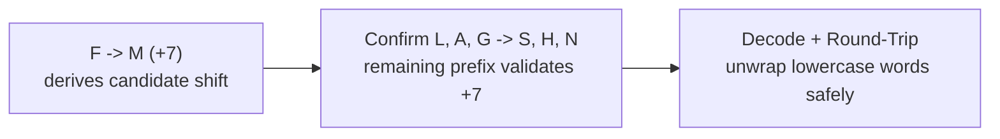

## The message

This practice puzzle gives you one line from a fictional beacon. Every letter moved forward by the same number of places in the English alphabet. Case and punctuation were preserved, and the original message had the format `FLAG{...}`. The line below is the complete input.

```text
MSHN{yvahapvuz_ylclhs_aol_zpnuhs}
```

Try finding the shift from the first four characters before reading on. The lowercase part is useful as a second check once you've worked out the prefix.

## The prefix gives you a test

The braces are still in the right places and the prefix is four letters long. That gives us four positions where we can compare what we see with what we expect. Write down the alphabet with `A` at position zero and count how far each expected letter moved.

```text
Plain     Index   Encoded   Index   Forward shift
F             5   M            12          7
L            11   S            18          7
A             0   H             7          7
G             6   N            13          7
```

The first pair (`F -> M`) derives a shift of seven; reserving `L`, `A`, and `G` as independent predictions confirms that all three match `+7` too. That agreement makes sense under the puzzle's fixed-shift rule.



The direction is easy to get backward. Seven is the distance the beacon moved the letters when it encoded them. Applying seven more places to `MSHN` gives `TZOU`. A shift of thirteen in the other direction gives `ZFUA`. Both produce letters, and both fail the one check we have before reading the body of the message.

## Walk the alphabet back

Subtract seven from each encoded letter's position and wrap at the start of the alphabet. In `yvahapvuz`, the first two letters give `r` and `o` without wrapping. The third letter is `a`, so `(0 - 7) % 26` gives `19`, or `t`. Continuing the same way gives `rotations`. That lowercase word comes from a part of the input we never used to choose seven.

For the script, make one translation table by rotating the uppercase and lowercase alphabets separately. Python leaves any character outside the table untouched. A short control string makes the edge cases easy to see. Shifting `Aa_Zz!` forward by seven should move `A` and `a` directly, wrap `Z` and `z` back to `G` and `g`, and leave the underscore and exclamation mark in place.

```python
from string import ascii_lowercase, ascii_uppercase

def shift_letters(text, places):
    places %= 26
    alphabet = ascii_uppercase + ascii_lowercase
    upper = ascii_uppercase[places:] + ascii_uppercase[:places]
    lower = ascii_lowercase[places:] + ascii_lowercase[:places]
    return text.translate(str.maketrans(alphabet, upper + lower))


message = "MSHN{yvahapvuz_ylclhs_aol_zpnuhs}"
shift = (ord("M") - ord("F")) % 26
assert shift_letters("FLAG", shift) == "MSHN"
assert shift_letters("Aa_Zz!", shift) == "Hh_Gg!"

flag = shift_letters(message, -shift)
assert flag.startswith("FLAG{") and flag.endswith("}")
assert shift_letters(flag, shift) == message
print(flag)
```

```text
FLAG{rotations_reveal_the_signal}
```

## What the checks establish

Re-encoding the result recovers the complete input, including case and punctuation. That is a check on the transformation. Any Caesar shift can pass a round trip when you use its inverse. The expected prefix and the legible words in the body are what distinguish seven from the other reversible shifts. Keeping those checks separate makes it easier to tell whether an unexpected result came from the hypothesis or the implementation.
