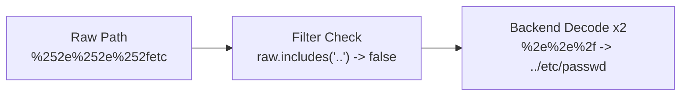

The edge log says the path passed validation. The framework log shows a different string. By the time the filesystem sees it, the percent escapes have disappeared and the remaining characters have a job to do. The mistake happened when one component approved a representation that another component was still going to transform.



## Follow the bytes through the request

Take `%252e%252e%252f` in a local string test. The proxy sees encoded percent signs. If it looks for a literal `..`, there is none to find. One decoding pass turns each `%25` into `%`, leaving `%2e%2e%2f`. A pass consumes escapes from its input and leaves the newly emitted percent signs in the output. If the framework or a helper then decodes that output, the two `%2e` sequences become dots and `%2f` becomes a slash. The result is a parent-directory segment and a separator.

```js
const assert = require('node:assert/strict');
const raw = '%252e%252e%252f';
assert.equal(raw.includes('..'), false);
const proxyValue = decodeURIComponent(raw);
assert.equal(proxyValue, '%2e%2e%2f');
assert.equal(decodeURIComponent(proxyValue), '../');
```


Assign URL decoding to one layer and define whether the framework hands the handler a raw component or a decoded parameter. Decode each component at the layer that owns it, validate the resulting application value there, and pass that value to the filesystem adapter. For an endpoint whose public identifiers are opaque ASCII names, reject escapes left in the decoded identifier along with separators and malformed encodings. An endpoint that legitimately accepts percent signs needs a contract that lets them remain literal all the way into the consumer.

A production regression should use the normal request entry point. Feed the encoded fixture through the configured proxy and framework, assert rejection at the application boundary, and assert that the file-opening dependency received zero calls. Include an ordinary filename as a control so a broken route that rejects everything cannot pass the suite. When proxy settings change, this test follows the bytes across the same boundary as the request.

## A path string and a file are different things


*Giovanni Battista Piranesi, The Drawbridge, Plate VII from Carceri d'Invenzione (2nd ed., 1761). Public domain, via Wikimedia Commons.*

Once the adapter gets a relative path, `path.resolve` and `path.relative` can establish lexical containment. Compare the relative result with the whole parent segment `..`, a prefix of `..` followed by the platform separator, and an absolute result. A plain `startsWith("..")` check also rejects legitimate names such as `..draft`. Decide separately whether an empty relative path is valid. An endpoint that serves a file usually needs to reject the root itself.

Now imagine that `uploads/avatar.png` is a symbolic link. The relative path still reads `avatar.png` after normalization because lexical operations see only the name. With an existing target in a directory that untrusted users cannot modify, resolve the root and candidate using `fs.realpathSync` and apply the containment check to the resulting paths. A realpath failure should fail the lookup. A dangling link, for example, has no resolved target to approve.

Mutable trees change the contract again. A directory entry can change between resolving the name and opening it. On systems that support it, `O_NOFOLLOW` protects the final component of an open and leaves intermediate components to ordinary traversal. For a policy that forbids symlinks throughout a writable tree, use an OS facility that constrains resolution at open time, or walk from a trusted directory descriptor using descriptor-relative opens that refuse symlinks at every step. Read using the returned descriptor. Opening the path again gives directory entries another chance to change.

Give the filesystem tests a private temporary tree covering an ordinary file, a sibling directory whose name shares the root prefix, and a symbolic link inside the root that resolves to a harmless fixture outside it. The sibling exercises lexical containment. The link exercises the filesystem policy. Where the platform cannot create symlinks for the test, report that coverage gap explicitly.

## The same characters can reach different parsers

Suppose a database field contains the eight ASCII bytes `alert(1)`. Read as plain text, they represent eight characters. Serializing the field into a JSON object emits `{"body":"alert(1)"}`, with the quotes, colon and braces supplied by the serializer. The field bytes now occupy a JSON string value. They are also different from a response consisting entirely of valid script source. The same glyphs have a different grammar in each representation.

```js
const assert = require('node:assert/strict');
const vm = require('node:vm');

const text = 'alert(1)';
const json = JSON.stringify({ body: text });
assert.equal(Buffer.byteLength(text), 8);
assert.equal(json, '{"body":"alert(1)"}');
assert.equal(Buffer.byteLength(json), 19);
assert.equal(JSON.parse(json).body, text);
assert.throws(() => new vm.Script('{"body":"alert(1)"}'), SyntaxError);
assert.doesNotThrow(() => new vm.Script('1 + 1'));
```

In that standalone script position the opening brace begins a block, and the colon following the quoted key produces a syntax error. The last assertion uses harmless source to show what successful script compilation looks like. It invokes no script. Some JSON forms, such as a top-level array, also parse as JavaScript expressions. That overlap in grammar alone gives ordinary JSON string elements no executable behavior.

A browser also decides whether the response can reach the parser. For script-like fetch destinations, `X-Content-Type-Options: nosniff` blocks a response whose MIME type is missing or is outside the JavaScript types. Without that header, handling depends on the destination, MIME type and browser rules. Executable bytes and a context that accepts them are separate prerequisites. Node's VM checks syntax here. The response test checks the HTTP contract. [Fetch Standard](https://fetch.spec.whatwg.org/#should-response-to-request-be-blocked-due-to-nosniff)

## Pin the contract on the response

Exercise the endpoint through its HTTP entry point with and without a format override. Include an error response because error handlers can use a different serializer. This assertion helper expects the endpoint's status and parsed JSON body from the fixture. It checks the wire headers before interpreting any bytes. Run the same assertions after middleware has finished, where a header override would actually reach the client.

```js
const assert = require('node:assert/strict');

async function assertJsonResponse(response, status, expected) {
  assert.equal(response.status, status);
  assert.equal(response.headers.get('content-type'), 'application/json; charset=utf-8');
  assert.equal(response.headers.get('x-content-type-options'), 'nosniff');
  assert.deepEqual(JSON.parse(await response.text()), expected);
}
```

Use that assertion for the normal JSON response, a request with `?format=html` that follows the endpoint's documented JSON response policy, and a request that yields a JSON error. For the success case, include a fixture containing quotes and line breaks. If a handler copies the field directly into the response or a middleware changes the media type, the test fails at the boundary where a client would observe the regression.
