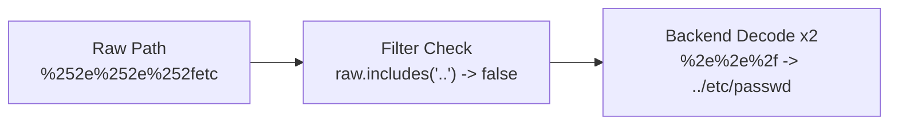

Whenever a security check runs on raw HTTP bytes before decoding or canonicalizing, you don't actually have validation—you just built a representation mismatch waiting for someone to encode past it.

Instead of speaking abstractly about "defense in depth," let's trace two exact places where validating pre-normalized strings breaks, and what a concrete fix + regression assertion actually proves.



## 1. Double-decode path traversal (`%252e%252e%252f`)

Suppose an edge filter checks the incoming request path for directory traversal *before* a backend framework decodes URL escapes a second time:

```js
const raw = "%252e%252e%252fetc%252fpasswd";
raw.includes("..");                 // false (edge filter approves)
const once = decodeURIComponent(raw);   // "%2e%2e%2fetc%2fpasswd"
const twice = decodeURIComponent(once); // "../etc/passwd"
```

That is not a race condition or a timing bug; it is a **representation mismatch**. The first filter scanned raw `%252e`, passed it onward, and left `%2e` intact for the backend's second `decodeURIComponent` pass.


Even once you canonicalize paths cleanly down to one UTF-8 string, **lexical checks (`path.relative`) are only half the barrier**. On disk, an ordinary-looking path inside `/var/app/uploads/avatar.png` can still be a symlink pointing outside the root. Safe filesystem access requires two distinct layers:

1. **Reject ambiguity:** Decode at most once cleanly, resolve `path.resolve(root, userRel)`, and reject if `path.relative(root, target)` starts with `..` or is absolute.
2. **Realpath / OS containment:** Resolve symlinks with `fs.realpathSync` (or OS `openat`/`O_NOFOLLOW`) against the resolved `root` before opening any file descriptor.

## 2. Stored JSON vs MIME sniffing in `<script>` contexts

A common confusion when reviewing APIs is mixing up **stored text**, **serialized JSON**, and **executable JavaScript**. Let's separate the actual bytes sent on the wire:

- Suppose an endpoint reflects valid JSON `{"body":"alert(1)"}`. Even if embedded directly inside `<script src="/api/profile">`, modern browsers still fail to execute it as JS because a top-level `{ ... ":" ... }` parses as a block statement with an invalid label:
  ```js
  new vm.Script('{"body":"alert(1)"}') // SyntaxError: Unexpected token ':'
  ```
- Execution requires either **arbitrary non-JSON bytes** (e.g., an endpoint reflecting unescaped raw input or an old JSONP callback) or a JSON array whose syntax happens to match JS script statements when sniffed, *combined with* permissive headers (missing `X-Content-Type-Options: nosniff` and weak `Content-Type` allowing browser MIME sniffing into `text/html` or `text/javascript`).

A missing `nosniff` header by itself does not prove XSS—you need both attacker-controlled syntax valid in the target browser context *and* the browser interpreting that response under the permissive MIME type.

Your regression suite should assert the response header contract explicitly: user input in `format` or query parameters cannot override `Content-Type: application/json; charset=utf-8`, and every API response locks down sniffing with `X-Content-Type-Options: nosniff`.
