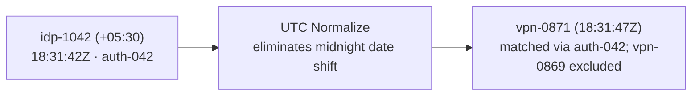

In this tabletop exercise, a sign-in alert arrives just after midnight local time. The identity provider says November 12, the VPN says November 11, and two VPN sessions for the same account appear within seconds of the sign-in. The handoff depends on working out which session belongs to the alert and recording how that match was made. The accounts, timestamps and records below are synthetic.

## Start with the source records

The detection record references an identity event. The identity and VPN records both carry an authentication reference. For this exercise the reference identifies the same transaction across those two systems. In a real export, check the field's documented scope before treating matching strings as proof of a shared transaction.

```text
Record      Timestamp                  What the source recorded
idp-1042    2026-11-12T00:01:42+05:30  sign-in accepted  demo-014  auth-042
vpn-0869    2026-11-11T18:31:44Z       session opened    demo-014  auth-041
vpn-0871    2026-11-11T18:31:47Z       session opened    demo-014  auth-042
alert-016   2026-11-11T18:34:05Z       new network alert for idp-1042
case-007    2026-11-12T00:07:00+05:30  analyst attached source exports
```

In the case record I would keep the original export, the source name, and the record ID alongside each extracted row. This lets a reviewer go back to the source when a field changes meaning or an analyst corrects the working timeline.

## Put both systems on the same date



The identity export's `+05:30` marks local time five hours and thirty minutes ahead of UTC. Subtracting that offset takes the 00:01 sign-in back to **November 11 at 18:31:42 UTC**. The analyst's case note also rolls back a day to **18:37:00 UTC**. Keep both the original value and the derived UTC value. If the original has no offset, record the time as unresolved until you can verify the source's time-zone settings. [RFC 3339, section 4.2](https://www.rfc-editor.org/rfc/rfc3339.html#section-4.2).

The arithmetic can be checked with Python 3.11 or later. The parser below requires an explicit offset so that a timestamp without one cannot silently inherit the laptop's local time zone.

```python
from datetime import datetime, timezone


def utc_timestamp(raw):
    value = datetime.fromisoformat(raw)
    if value.utcoffset() is None:
        raise ValueError("Timestamp is missing its UTC offset")
    return value.astimezone(timezone.utc)


sign_in = utc_timestamp("2026-11-12T00:01:42+05:30")
nearby = utc_timestamp("2026-11-11T18:31:44Z")
session = utc_timestamp("2026-11-11T18:31:47Z")
alert = utc_timestamp("2026-11-11T18:34:05Z")
case_note = utc_timestamp("2026-11-12T00:07:00+05:30")

assert sign_in.isoformat() == "2026-11-11T18:31:42+00:00"
assert case_note.isoformat() == "2026-11-11T18:37:00+00:00"
assert (nearby - sign_in).total_seconds() == 2
assert (session - sign_in).total_seconds() == 5
assert (alert - sign_in).total_seconds() == 143
```

## Test the competing match

The nearest session is `vpn-0869`, only two seconds after the sign-in and under the same account. Its reference is `auth-041`. The session five seconds away, `vpn-0871`, carries `auth-042` and matches the sign-in record. The closer result is a concrete example of why time and account are useful search filters but weak evidence for a join.

Time still has limits after normalization. UTC conversion deals with time zones. A clock already running several seconds fast keeps that error after conversion. In this case, keep the observed five-second gap in the notes and record the clock status as unverified. If clock skew is measured later, record when and how it was measured before using it to refine the ordering.

The 143 seconds between the sign-in and alert creation also needs a precise label. The exercise gives no ingestion timestamp. The observed interval can include transport, ingestion, and time until the rule evaluates the event. The case note shows when the analyst attached records and belongs in the response timeline.

## Leave a question the next shift can answer

Structure the handoff around four fields so the oncoming responder sees what is proven, what isn't, and what record settles the tie:

- **Established join:** `alert-016` -> `idp-1042` (`18:31:42Z`) -> `vpn-0871` (`auth-042`); competing session `vpn-0869` carried `auth-041` and is excluded.
- **Unresolved fallback:** If a real export drops the correlation ID and both sessions fit the window, keep **both candidates** open in the timeline and name the next distinguishing artifact (source client IP, TLS fingerprint, or endpoint process event).
- **Open owner action:** Check the device identifier against inventory and verify the sign-in with `demo-014`'s owner over an out-of-band channel.
- **Audit rule:** Record follow-ups as new timestamped entries rather than overwriting earlier working notes. [NIST SP 800-61 Rev. 3, investigation records](https://csrc.nist.gov/pubs/sp/800/61/r3/final).
