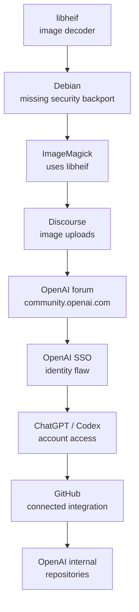

The proof was a pull request. Hacktron researchers Harsh Jaiswal, Mohan Pedhapati and Rahul Maini used an employee's Codex access to open a harmless test PR in OpenAI's internal monorepo, then stopped testing. The first component they had to understand was a C library that turns HEIF data into pixels. Hacktron reports less than 72 hours from the discovery to reaching the internal repositories and under $3,000 in API tokens for the work. Those figures describe a specific investigation, with human decisions about what to test and where to stop. [Hacktron disclosure](https://www.hacktron.ai/blog/hacking-openai) · [LiveOverflow: How OpenAI got hacked with an image](https://youtu.be/gjHh9g7yo9Y) · [Follow-up: OpenAI Hacked with a 1-Year-Old Bug](https://youtu.be/qypnjORyWNI)

## The fix existed upstream

Start at the bottom of the image stack. `libheif` interprets HEIF containers, which carry structured data about encoded images before a service can generate a thumbnail. The parser has to make allocation decisions based on what it reads and keep later writes inside the resulting buffers. A heap buffer overflow means that contract failed. The affected operation can write beyond the bounds of its allocation, corrupting memory that belongs to something else inside the process.

The researchers found that upstream had already corrected the defect, with no CVE or security advisory attached to the fix at the time. Debian's package used by the deployment lacked the backport. Those two facts explain the scanner blind spot. A scanner that matches installed packages against published CVE records needs an identifier, affected package information and a version range. An ordinary upstream commit supplies no such join key. The installed version can match everything the scanner knows about and still contain the earlier implementation. The useful question here was whether the exact package contained a particular correction, including any equivalent patch in the distribution's source. [Hacktron disclosure](https://www.hacktron.ai/blog/hacking-openai)

ImageMagick supplied the next link. A product team can think of it as the program that resizes an uploaded image. Format support makes it a dispatcher into other code, including `libheif`. That expands the set of libraries that handle attacker-controlled input even when the web application's manifest never names them. An inventory that stops at the Ruby application and ImageMagick misses the dependency doing the format-specific work.

## The job queue still sits on the public input path

In Discourse, image processing follows the upload into a worker. The HTTP transaction can finish before the conversion starts, but the bytes carry the same trust level across the queue. Depending on forum settings the upload route may require an account. The decoder still receives data from people who have no authority to run code on the server. A background queue changes when and where the operation runs. The native decoder remains part of the set of components the public service depends on to enforce that boundary.

That distinction matters during incident triage. The first process to see a parser fault may be a media worker, and the visible web request may have returned successfully. Correlating queue job IDs, media conversion failures and worker lifecycle events gives defenders a better picture than filtering HTTP logs for server errors. It also makes the worker's credentials and network reach relevant to the initial blast radius, even if the public endpoint has its own gateway rules.

Hacktron describes using Claude Opus during development and validation. The team's timeline moves from tracing the upload path on July 23 to local code execution on July 24 and a local result with address randomization enabled on July 25. They then report validating execution on their own Discourse Cloud instance before demonstrating it on `community.openai.com`. The stages establish different facts. A local failure establishes that the decoder mishandled input. The reported host result establishes that the deployed forum's conversion path reached the affected native code and that the researchers obtained execution in that environment. [Hacktron disclosure](https://www.hacktron.ai/blog/hacking-openai)

## The forum and the employee account had separate boundaries

Code execution on the forum put the Discourse environment at risk, including the resources available to its runtime. The model infrastructure sat outside that demonstrated boundary. Reaching employee ChatGPT and Codex accounts depended on a separate misconfiguration involving “Sign in with OpenAI.” That was a failure in the relationship between the public relying party and the identity system. The forum's image decoder could be patched independently, and the identity integration would still warrant its own remediation and validation.

What the researchers could show next depended on an employee's connected services. Codex carried access to a connected GitHub integration. The test PR established that they could perform a repository action through that integration under the affected account's authority. Its significance was the ability to cross into an internal repository and carry out a controlled write. The public report describes other connectors as potential exposure and gives the PR as the concrete proof. It also records that OpenAI's bounty recognized the OpenAI-side finding and that the Discourse-hosted forum was excluded from OpenAI's program scope. [Hacktron disclosure](https://www.hacktron.ai/blog/hacking-openai)

The repository action also illustrates why a connector deserves its own audit trail. A responder should be able to correlate the sign-in, the developer tool session and the resulting GitHub operation while retaining each service's account and authorization context. That makes it possible to distinguish repository actions actually performed from access that was merely possible.

## Close the decoder and identity paths independently

**Identify the live decoder.** From the worker's image or namespace, use `ldd` on the trusted ImageMagick executable and, when the format coder loads dynamically, on the pertinent coder module. Inspect a running conversion process's mapped shared objects to corroborate which `libheif.so` it actually loaded. Resolve the path to its package revision or image artifact, then verify the fix against the package source or vendor guidance. Discourse published rebuild guidance and added image-processing sandboxing as defense in depth. [Discourse security advisory](https://github.com/discourse/discourse/security/advisories/GHSA-vhm9-85gw-x335)

**Exercise the ordinary upload path.** Send a benign `.heic` fixture through the production route and verify the expected thumbnail or policy rejection. For supported HEIF uploads, tie the resulting job to a worker on the rebuilt image and confirm the mapped decoder. A package record proves what shipped. A completed job and mapped library prove which component the service used. Cover every deployed worker pool that can consume those jobs.

**Give the converter less authority.** Run native decoding with a read-only base filesystem, a bounded writable scratch area, resource limits and no outbound network or metadata access. Keep application and identity secrets outside the conversion sandbox. Verify those controls at the worker boundary, where any codec execution would inherit whatever permissions are present.

**Separate forum sign-in from employee tooling.** Give the public forum a dedicated identity client with its own narrowly scoped grants and audience. Verify with test accounts that forum tokens and sessions cannot be redeemed for employee application access or authorize developer integrations. Review connected GitHub access in terms of the repositories and actions it actually grants. The closure evidence should cover both services: which decoder executed the real upload job, and which authority the forum's identity client can exercise after sign-in.
