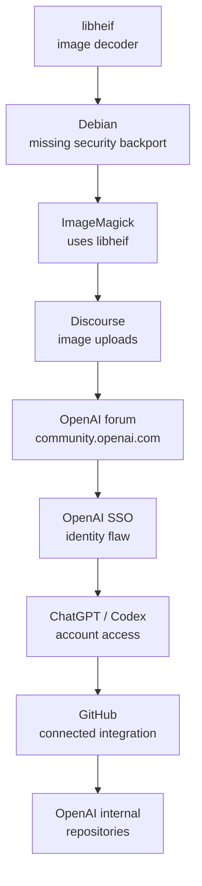

Picture uploading an innocent-looking `.heic` photo to a public community forum, burning under **$3,000 in LLM API tokens**, and waking up with a proof-of-concept pull request open inside **OpenAI's internal monorepo** in under 72 hours.

That was **HEIF Heist**, published by Hacktron AI researchers Harsh Jaiswal, Mohan Pedhapati, and Rahul Maini ([hacktron.ai/blog/hacking-openai](https://www.hacktron.ai/blog/hacking-openai)). On paper, nobody breached frontier-model weights directly. What actually broke was a nine-hop dependency and trust chain hiding in plain sight: **an unbackported `libheif` fix on Debian, passed through ImageMagick and Discourse, chained across a separate OpenAI SSO flaw straight into employee Codex/GitHub access**.

## Step 1: The Debian packaging gap (`libheif` -> `ImageMagick` -> `Discourse`)

XKCD #2347 joked back in 2020 that *"Someday ImageMagick will finally break for good and we'll have a long period of scrambling."* That punchline landed squarely on `community.openai.com`.

Discourse processes user image uploads by routing files into **ImageMagick**, which delegates modern HEIC/HEIF containers straight down to native **`libheif`**. When Hacktron inspected upstream `libheif` git history, they spotted a heap buffer overflow commit that had been patched silently upstream **without a CVE or security advisory**.

Because distro security trackers match on formal CVEs rather than raw upstream commits, Debian missed the security backport. Container builds passed vulnerability scanners with green checkmarks while loading a vulnerable C heap decoder into every public image worker.

## Step 2: Turning a crash into Discourse RCE

Finding a heap corruption primitive inside a native media library is usually just Week One of painstaking heap grooming. Using Claude-assisted analysis to reason over allocator behavior and construct the malformed container headers, Hacktron turned that `.heic` upload into **Remote Code Execution directly on the `community.openai.com` Discourse host**.

Keep the trust boundary straight: compromising the forum gave control of Discourse's worker runtime, local filesystem, and host secrets—not OpenAI's training clusters. That alone would have stayed a community-host RCE if identity isolation had held.

## Step 3: `OpenAI SSO` -> `ChatGPT / Codex` -> `GitHub` -> `Internal Repos`

Instead, Discourse sat wired into a separate **"Sign in with OpenAI" SSO identity flaw**. Pairing host access on `community.openai.com` with that SSO bug let the researchers pivot into **OpenAI employee ChatGPT and Codex sessions**, inherit connected **GitHub integration** permissions, and open a harmless test PR inside OpenAI's internal repositories before immediately halting and disclosing the entire chain.

## Defender closure checks that actually catch this

If you run media upload pipelines or external community apps, "we patched Discourse" isn't enough evidence:

- **Audit the live shared object:** Check the actual `libheif.so` loaded inside your running image worker (`ldd` / container base image SBOM), because upstream C memory fixes routinely skip distro backports without a CVE.
- **Sandbox native media parsers:** Strip capabilities, drop outbound network/metadata egress, and mount read-only scratch paths so an ImageMagick/codec RCE cannot sniff service tokens or pivot laterally.
- **Prove pipeline closure cleanly:** Record both the Discourse patch and the rebuilt `libheif` package hash, then upload a benign `.heic` fixture through the real thumbnail worker and verify which library version executed it.
- **Sever public forums from employee SSO:** A compromised marketing site or community forum must never hold identity leverage over employee developer tooling or connected GitHub integrations.
