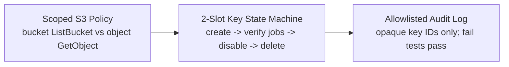

Half of cloud "least privilege" work fails not because engineers forgot to write JSON, but because they never tested the policy boundary with negative inputs or walked through what happens when an automated key rotation crashes halfway through.

Putting IAM scope, credential rotation, and audit logging in one pipeline exposes where those three pieces quietly contradict each other.



## 1. Bucket ARNs vs object ARNs (and `IfExists` traps)

The fastest way to break least privilege in AWS S3 is confusing `s3:ListBucket` (a **bucket-level** action taking the bucket ARN) with `s3:GetObject` (an **object-level** action taking the object key ARN). Put `arn:aws:s3:::app-artifacts/prod/*` on `s3:ListBucket` and listing fails outright; widen `s3:GetObject` to the bucket root to "fix" it and you just leaked every folder in the bucket.

```json
{
  "Version": "2012-10-17",
  "Statement": [
    {
      "Sid": "ListOnlyProdPrefix",
      "Effect": "Allow",
      "Action": "s3:ListBucket",
      "Resource": "arn:aws:s3:::app-artifacts",
      "Condition": {
        "StringLike": { "s3:prefix": ["prod/releases/*"] },
        "Null": { "s3:prefix": "false" }
      }
    },
    {
      "Sid": "ReadOnlyProdReleases",
      "Effect": "Allow",
      "Action": "s3:GetObject",
      "Resource": "arn:aws:s3:::app-artifacts/prod/releases/*"
    }
  ]
}
```

Two condition-key traps show up repeatedly during policy reviews:
- **`IfExists` passes on missing keys:** A condition like `StringEqualsIfExists` evaluates to `true` whenever a request omits that condition key completely. Whenever a key *must* be present, enforce `"Null": { "s3:prefix": "false" }` explicitly.
- **Prefix collisions:** Never rely on `prod/release*` without a trailing slash (`prod/releases/*`), or `prod/release-secrets/` matches too.

Before approving any IAM diff, run four concrete checks: allowed path (`prod/releases/v1.tar.gz` -> Allow), sibling path (`staging/v1.tar.gz` -> Deny), deceptively similar prefix (`prod/releases-old/` -> Deny), and omitted `prefix` on `ListBucket` (Deny).

## 2. Dual-key rotation as a recoverable state machine

IAM users only have **two access-key slots total**, and inactive keys still consume a slot. A brittle script that assumes an empty slot will crash mid-run—or worse, delete the active key blindly before verifying consumers migrated.

```python
def plan_key_rotation(slots: list[dict], new_ok: bool, secret_store_written: bool) -> dict:
    active = [k for k in slots if k["status"] == "Active"]
    inactive = [k for k in slots if k["status"] == "Inactive"]
    assert len(slots) <= 2, "IAM user exceeds 2-key limit"
    if len(slots) == 2 and inactive:
        raise ValueError("Refusing blind delete of inactive slot before inventory")
    if len(slots) == 2:
        raise ValueError("Both slots full; serialize or retire verified slot first")
    if not secret_store_written:
        raise RuntimeError("Deactivate orphaned replacement key before aborting")
    return {"promote": new_ok, "active_count": len(active), "next_state": "observe_window" if new_ok else "rollback"}
```

Safe zero-downtime cutover follows a strict order:
1. Inventory both slots and serialize rotations per principal.
2. Create the new key -> write it atomically to your secret store. If the secret-store write fails, immediately deactivate/rollback the newly minted key cleanly rather than leaving an orphan in slot 2.
3. Verify the replacement key through **real consumer runs** (including infrequent cron/batch jobs—a quiet `AccessKeyLastUsed` timestamp alone only proves nobody called it *today*, not that next Sunday's billing job doesn't embed the old key).
4. Mark the old key `Inactive`, monitor through one full infrequent-job window, and only then delete it.

## 3. Audit records that cannot leak on failure

The exact moment a rotation script is most dangerous is when `CreateAccessKey` succeeds and `PutSecretValue` fails: dumping raw SDK responses or exception stack traces directly into structured logs routinely prints the plaintext `SecretAccessKey`.

Emit a fixed allowlisted JSON contract instead, storing **opaque key IDs/hashes only**:

```json
{
  "timestamp_utc": "2026-11-16T09:14:22Z",
  "rotation_id": "rot-20261116-ci-artifacts",
  "principal_ref": "arn:aws:iam::111122223333:user/ci-publisher",
  "old_key_id": "AKIA...OLD4",
  "new_key_id": "AKIA...NEW9",
  "transition": "new_created -> secret_store_failed -> new_deactivated",
  "actor": "rotation-worker-02",
  "provider_request_id": "7f91c2a0-4c9a-11f1-8d2e-9b1c209f11a4",
  "consumer_verified": false,
  "error_code": "SECRET_STORE_WRITE_TIMEOUT"
}
```

Test that failure path explicitly with a synthetic dummy credential in CI: trigger a forced secret-store write failure right after creation and assert the resulting audit log matches zero secret patterns (`AKIA...` secret material or raw exception blobs). If the failure log is safe, the happy path is too.
