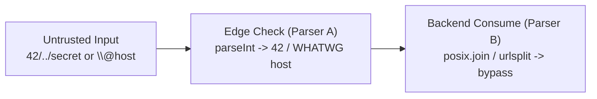

Most input-validation vulnerabilities do not start with an attacker inventing raw syntax out of thin air. They start when one component inspects input with Parser A, approves it, and hands the exact same string to Parser B, which walks away with a different answer.

Start with the value the validator approved and put it beside the value the next component received. In an Express-style route the difference can be a number versus a filename. In a gateway it can be the hostname itself.


*Pieter Bruegel the Elder, The Tower of Babel (Vienna, 1563). Public domain, via Wikimedia Commons.*



## 1. Permissive integer prefix parsing (`parseInt`)

Suppose an API route looks up an item file by numeric ID from `req.params.id`:

Imagine a handler that reads `Number.parseInt(req.params.id, 10)`, checks that the result is positive, then passes `req.params.id` itself to `path.posix.join`. The first operation consumes a decimal prefix. The second uses the full string and interprets separators and parent segments. The log can say item 42 even though the lookup selected a different name.

In this local fixture `..` cancels the `42` segment. The resulting file is still inside the item directory at `/var/app/items/secret.json`. The test begins with the parameter value presented to the handler and stops at path construction. Its failure condition is a disagreement between the approved ID and the requested filename.

```js
const assert = require('node:assert/strict');
const path = require('node:path').posix;

function validateId(raw) {
  if (typeof raw !== 'string' || !/^[1-9][0-9]*$/.test(raw)) return null;
  const id = Number(raw);
  return Number.isSafeInteger(id) ? id : null;
}

const raw = '42/../secret.json';
assert.equal(Number.parseInt(raw, 10), 42);
assert.equal(path.join('/var/app/items', raw), '/var/app/items/secret.json');
assert.deepEqual(['42', raw, '42abc', '', '0', '042', '42\n', '9007199254740992']
  .map(validateId), [42, null, null, null, null, null, null, null]);
assert.equal(path.join('/var/app/items', String(validateId('42'))), '/var/app/items/42');
```

Choose one spelling for the identifier. This fixture accepts positive safe integers written as ASCII decimal digits without leading zeroes. The grammar rejects signs, whitespace, partial numbers and separators before conversion. The safe-integer check keeps nearby large IDs from rounding to the same number. The handler can carry the returned number as its identifier and convert it to a string at the path boundary. A lookup trace now has one value to follow from validation to filename. Any change to accepted spellings belongs in the request contract because aliases affect cache keys and logs too.

## 2. Duplicate query keys: scalar, substring, or array?

Query parsers disagree sharply when a key appears zero, one, or two times (`?role=guest&role=admin`).

In a multi-value helper (`searchParams.getAll('role')`), the result is always an array (`["guest", "admin"]`). A naive check calling `.includes("admin")` behaves completely differently depending on what type landed in memory:

- On a string `"admin,guest"`, `"admin,guest".includes("admin")` is **`true`** (substring match!).
- On a single-element array `["admin,guest"]`, `["admin,guest"].includes("admin")` is **`false`** (membership match!).
- On duplicate keys `?role=guest&role=admin`, a framework binding into `req.query.role` as an array fails strict string checks, whereas a framework using "first/last value wins" hides earlier parameters checked by a WAF.

Notice another subtle edge case: enforcing `values.length <= 1` allows **zero** occurrences (missing required parameter!). A required scalar must reject both missing (`0`) and repeated (`>= 2`) keys:

```js
function parseSingleToken(values) {
  if (values.length !== 1) return null; // rejects [], allows ["abc"], rejects ["a", "b"]
  return values[0];
}
```

| Occurrences | Query | Values from `getAll` | Required scalar |
| --- | --- | --- | --- |
| 0 | empty query | `[]` | Reject |
| 1 | `?role=guest` | `["guest"]` | Accept `guest` |
| 2 | `?role=guest&role=admin` | `["guest", "admin"]` | Reject |

A first-value accessor returns `guest` for that last row, while a last-value binding gives `admin`. Once a binding collapses the values, the validator cannot recover the fact that the key appeared twice. Read all occurrences before making a cardinality decision. Exactly one still allows a blank value, so the allowlist has a separate job. Comma splitting would introduce another grammar and should be an explicit policy choice.

Carry the single validated token forward when a downstream operation needs the requested role. Any grant of privileges comes from the authenticated principal's permissions. A valid spelling answers whether the request has the right shape. A permissions check answers whether the principal may use it. Keep both checks visible in the handler so a change in binder behavior cannot silently take over either job.

## 3. URL authority differentials (Node vs Python)

Cross-language proxies are where parser differentials turn genuinely nasty—especially on backslashes inside authority sections:


Both runtimes return structured fields, but they disagree on where the authority ends. Node's WHATWG parser treats a backslash in this HTTP URL as a path separator. Python's `urlsplit` keeps it in the network location and interprets the text before the at sign as user information. Python documents `urlsplit` as a practical parser that accepts input from multiple URL conventions. These assertions pin its behavior on this fixture. [Python URL parsing security](https://docs.python.org/3/library/urllib.parse.html#url-parsing-security)

```js
const assert = require('node:assert/strict');
const input = String.raw`http://allowed.internal\@attacker.example/`;
const url = new URL(input);
assert.equal(url.hostname, 'allowed.internal');
assert.equal(url.pathname, '/@attacker.example/');
assert.equal(url.href, 'http://allowed.internal/@attacker.example/');
```

```python
from urllib.parse import urlsplit

raw = urlsplit(r"http://allowed.internal\@attacker.example/")
assert raw.netloc == r"allowed.internal\@attacker.example"
assert raw.hostname == "attacker.example"
assert raw.path == "/"

canonical = urlsplit("http://allowed.internal/@attacker.example/")
assert canonical.hostname == "allowed.internal"
assert canonical.path == "/@attacker.example/"
```

Both tests inspect parsed fields locally. On the original bytes the two hostnames disagree. On the serialized URL the receiver agrees with Node because a forward slash already separates the authority from the path. A gateway that checks `hostname` but hands off the original text gives the downstream client a different decision to make.

Parse at the boundary, validate the scheme, host, port and credential policy on the structured result, then serialize that approved value for downstream use. Keep the raw string out of the transport path. In a cross-runtime contract test, parse the serialized form on the receiving side and assert agreement on all fields that informed approval. A redirect introduces a new URL with its own validation decision. The handoff test establishes agreement on authority and path. Connection policy separately governs redirects and where a name resolves.

Use matched controls in each regression. A valid ID must still reach its intended lookup, a single guest token must survive the binder, and a normal URL must retain its host and path. A validator that rejects every request would pass a suite built only around malformed inputs. The success cases keep the boundary usable.

The filename comes from the approved number, the role comes from the approved scalar, and the URL string comes from the approved URL object. During a review, trace each of those values into the consumer. A beautifully strict validator can still sit unused beside a lookup that reads directly from the request.

Next up is [Validate First, Decode Later](/writeups/check-before-decode-normalization-traps).
