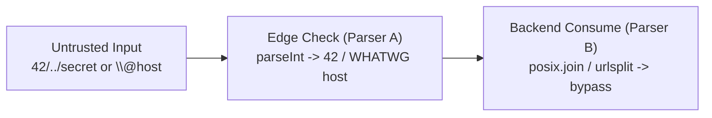

Most input-validation vulnerabilities do not start with an attacker inventing raw syntax out of thin air. They start when one component inspects input with Parser A, approves it, and hands the exact same string to Parser B, which walks away with a different answer.

I kept running into three flavors of this bug when reviewing Express-style routes and Python gateways. None of them require exotic payloads—only two components disagreeing on type, delimiter, or authority.



## 1. Permissive integer prefix parsing (`parseInt`)

Suppose an API route looks up an item file by numeric ID from `req.params.id`:

```js
app.get('/items/:id', (req, res) => {
  const id = Number.parseInt(req.params.id, 10);
  if (!Number.isInteger(id) || id <= 0) {
    return res.status(400).end();
  }
  const safePath = path.posix.join('/var/app/items', req.params.id);
  return res.sendFile(safePath);
});
```

On the input `"42/../secret.json"`, `Number.parseInt("42/../secret.json", 10)` reads leading digits until it hits the slash and returns **`42`**—passing the integer check—while `path.posix.join('/var/app/items', req.params.id)` consumes the raw parameter (`"/var/app/secret.json"`).

Fix both the check and the serialization: validate the exact byte string before conversion, then pass the parsed value downstream, never the raw token:

```js
function validateId(raw) {
  if (typeof raw !== "string" || !/^\d+$/.test(raw)) return null;
  const n = Number(raw);
  return Number.isSafeInteger(n) && n > 0 ? n : null;
}
// ["42", "42abc", "", "0"] -> [42, null, null, null]
```

## 2. Duplicate query keys: scalar, substring, or array?

Query parsers disagree sharply when a key appears zero, one, or two times (`?role=guest&role=admin`).

In a multi-value helper (`searchParams.getAll('role')`), the result is always an array (`["guest", "admin"]`). A naive check calling `.includes("admin")` behaves completely differently depending on what type landed in memory:

- On a string `"admin,guest"`, `"admin,guest".includes("admin")` is **`true`** (substring match!).
- On a single-element array `["admin,guest"]`, `["admin,guest"].includes("admin")` is **`false`** (membership match!).
- On duplicate keys `?role=guest&role=admin`, a framework binding into `req.query.role` as an array fails strict string checks, whereas a framework using "first/last value wins" hides earlier parameters checked by a WAF.

Notice another subtle edge case: enforcing `values.length <= 1` allows **zero** occurrences (missing required parameter!). A required scalar must reject both missing (`0`) and repeated (`>= 2`) keys:

```js
function parseSingleToken(values) {
  if (values.length !== 1) return null; // rejects [], allows ["abc"], rejects ["a", "b"]
  return values[0];
}
```

## 3. URL authority differentials (Node vs Python)

Cross-language proxies are where parser differentials turn genuinely nasty—especially on backslashes inside authority sections:


Tested directly in Node (`new URL`) vs Python (`urllib.parse.urlsplit`) on `"http://allowed.internal\\@attacker.example/"`:

```text
Node new URL()    -> { host: 'allowed.internal', pathname: '/@attacker.example/' }
Python urlsplit() -> { netloc: 'allowed.internal\\@attacker.example', hostname: 'attacker.example', path: '/' }
```

A Node gateway checking `url.hostname === 'allowed.internal'` waves the request straight through because WHATWG treats `\` as a path separator, putting the host first and moving `@attacker.example` into `pathname`. Behind it, Python's RFC-style `urlsplit` parses `allowed.internal\` as `userinfo` and routes outbound requests straight to **`attacker.example`**.

The fix is simple to write and annoying to enforce: **parse once, validate the canonical serialized result, and forward that typed output—never the original untrusted string.** Next up: [Validate First, Decode Later](/writeups/check-before-decode-normalization-traps).
