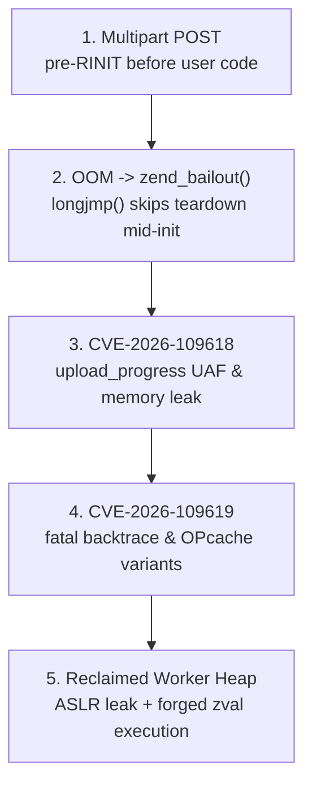

A PHP route can require a login and still accept work from a stranger. Follow a multipart POST into the worker and the order becomes clear. Before a controller reads the request, native code has already handled its headers, created data structures for its fields, and possibly touched the session. PHP2Shell showed what that early work could cost. Researchers reported unauthenticated memory disclosure and demonstrated remote code execution on affected deployments of WordPress, Drupal, and Joomla. Three application stacks shared the same runtime boundary. [PHP2Shell disclosure](https://www.php2shell.com/)

The diagram sketches the request-to-impact arc. The two CVE numbers cover families of related lifetime bugs, and their individual variants need to be read against the disclosure.

## The body arrives before the router

*Giovanni Domenico Tiepolo, The Procession of the Trojan Horse into Troy (c. 1760). Public domain, via Wikimedia Commons.*

Start with the socket. A web server accepts HTTP bytes, interprets the headers, and decides where to send the body. With Apache prefork and `mod_php`, the Apache child hosts the PHP interpreter. With PHP-FPM, the web server hands the request off over FastCGI and a separate pool worker runs PHP. Either way, the worker can serve many requests before it exits. Userland startup happens only after the runtime has begun constructing the request's environment.

In that startup path, multipart parsing recognizes boundaries, collects field metadata and handles temporary uploads. With `session.upload_progress.enabled` on, the session extension can also update upload progress while the body is being received. This timing matters to applications that call `session_start()` later or enforce login in middleware. PHP can already be processing session-related state while the application is still waiting to run. [PHP upload progress documentation](https://www.php.net/manual/en/session.upload-progress.php)

Three settings limit three different things. `post_max_size` bounds the size of the incoming POST body PHP accepts for processing. `max_file_uploads` limits the count of simultaneously uploaded files. `memory_limit` limits memory PHP accounts to the request. An accepted body still has to be represented inside the interpreter. Field names, values, table entries, strings and parser bookkeeping have allocation costs of their own. The file count tells you little about that work, and a body below its byte ceiling can still run out of memory. A reverse proxy body limit can reduce exposure, but the worker's error handling must remain correct even for requests the proxy accepts. [PHP core configuration reference](https://www.php.net/manual/en/ini.core.php)

## A request ends. The worker keeps going.

A native function can ordinarily free its temporary data or restore a structure before returning an error. PHP's fatal allocation path can instead call `zend_bailout()`, which uses C's `longjmp()` to return directly to a recovery point. Any cleanup that depended on control returning through the intervening functions gets skipped. Think of an update with several steps: allocate, link, initialize, then release the previous state. If allocation fails midway through an update elsewhere in that sequence, the code at the recovery point has to cope with whatever state was visible when the jump happened.

The difficult case is a pointer whose owner survives the request. PHP can reclaim the request's memory after the failure while a process-level field still refers to it. That field may appear intact because an address is still stored there. The object's lifetime has already ended. Later work can touch the field, and the allocator is free to put another object at the address in the meantime. The risk exists even when the client sees an ordinary request failure and the service keeps answering.

The disclosures assign the upload-progress unserializer use-after-free and a worker memory-disclosure variant to **CVE-2026-109618**. **CVE-2026-109619** includes other persistent-state failures, notably a fatal-error backtrace use-after-free and an OPcache type-confusion variant. They share a bailout and ownership problem. A later request encountering stale state is a consequence that can recur across variants, rather than a second mandatory step labeled with its own CVE. [Wiz research disclosure](https://www.wiz.io/blog/php2shell-php-rce)

## What a stale pointer can expose

When code uses an address after its original allocation is released, the outcome depends on what the runtime does with it. A read can disclose data left in process memory. A write or cleanup operation can interpret the replacement data as the previous object's fields. That matters in Zend because a `zval` carries both a value and type information. Arrays and references involve heap objects with their own lifetime rules. If a type or pointer is no longer trustworthy, ordinary engine operations such as inspecting or destroying a value can act on memory with the wrong assumptions.

Address space layout randomization raises the bar by moving code and data to different addresses across process starts. Its protection depends in part on those addresses staying private. A pointer into a loaded binary can reveal information about that process's layout. This is why an incident assessment has to take a memory disclosure seriously even when the available evidence shows neither a crash nor code execution. The disclosure and execution variants can affect different deployments, and an execution finding inherits the authority of the PHP worker. That might be the `www-data` account on a Debian-derived deployment, with access determined by its filesystem mounts, runtime secrets, permissions and network policy. [PHP2Shell disclosure](https://www.php2shell.com/)

That also changes what you preserve when investigating a suspected compromise. Capture the serving image identity, pool settings and worker lifecycle records before replacement where your incident procedure permits. Correlate allocation failures or unexpected child exits with proxy request metadata and endpoint activity. A fatal error can come from ordinary load, so treat that correlation as a lead. Give filesystem changes, unexpected process launches and connections from the PHP service account their own evidentiary weight.

## Verify the process that handles the POST

Disabling `session.upload_progress.enabled` removes an early session path from the effective configuration. The fatal-error and OPcache findings still require a runtime patch. Upstream fixed the affected release lines in **8.2.35, 8.3.36, 8.4.27 and 8.5.12**. For distribution packages, check the vendor advisory for the installed package revision because vendors can backport security fixes while retaining an older upstream version number. [PHP 8 changelog](https://www.php.net/ChangeLog-8.php)

Begin verification at the virtual host or ingress. Trace it to the Apache service or FPM socket and pool that execute its PHP. On Linux, inspect the live FPM process executable via `/proc/<pid>/exe`. For Apache with `mod_php`, inspect the loaded PHP module in the child process's memory maps. Resolve those paths inside the worker's container or mount namespace where applicable. Compare the executable or module to the patched artifact and record when the serving PIDs started. A replaced module can remain mapped in a process after the old file disappears from the filesystem.

Check each serving replica after rollout, including workers draining requests during a graceful restart. Compare the process start times with the update or deployment time and verify one ordinary application request through the service path. `php -v` identifies the CLI selected by the shell. Closure evidence ties the patched image or package to the live workers where the request body is actually parsed.
