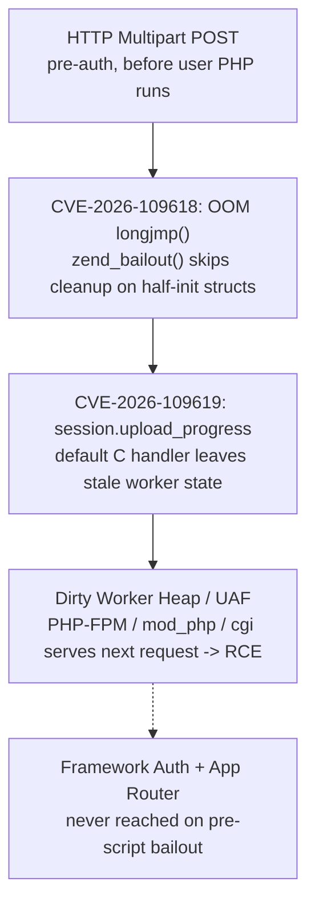

Most developers treat HTTP security like a bouncer at a framework controller. You write middleware, validate tokens in Symfony or Laravel, lock down routes, and figure anything hitting `/` safely gets turned away at the door.

**PHP2Shell** was the October 2026 reminder that PHP does not invite HTTP requests straight into your PHP script. Before a single line of index routing or auth middleware runs, the request lands inside PHP's C SAPI and multipart parser.

Disclosed across coordinated findings from researchers at Wiz, OpenAI, and Calif, the label covers two distinct critical core bugs (**CVE-2026-109618** and **CVE-2026-109619**, CVSS 9.2) affecting PHP versions back to 5.4 across **PHP-FPM**, **Apache `mod_php`**, **`php-cgi`**, **FrankenPHP**, and **LiteSpeed**.

## Two runtime bugs under one nickname

Lumping both CVEs into a single vague "upload bug" hides why partial config tweaks fail. They are separate runtime flaws that happen to share the same pre-script neighborhood:

| CVE | Runtime path | Configuration / trigger | Core mechanism |
|---|---|---|---|
| `CVE-2026-109618` | Request startup & multipart allocation | Crafted request hits `memory_limit` mid-init | Out-of-memory `zend_bailout()` calls `longjmp()`, skipping destructors and leaving partially initialized structs for cleanup |
| `CVE-2026-109619` | `session.upload_progress` C handler | Default-enabled `session.upload_progress` with multipart form data | Early upload tracking mutates session globals before user code executes, stranding stale state across worker requests |

The terrifying shared ingredient isn't magic cryptography or some zero-day framework bypass. It is C error-handling semantics colliding with persistent worker lifetimes.

## What `longjmp()` actually breaks

In normal C++ or Rust code, unwinding runs destructors as frames pop. PHP's Zend engine uses `setjmp`/`longjmp` via `zend_bailout()` to abort execution immediately when a fatal error or Out-Of-Memory (OOM) condition hits.

When an unauthenticated attacker sends a carefully shaped `multipart/form-data` request engineered to spike memory allocation inside header or file-part parsing, `longjmp()` yanks control flow straight out of the half-finished parser routine. Buffers, hash tables, or session tracking pointers may already be linked into global request/worker state without having finished initialization — or freed while an outer pointer still references them.

In a persistent SAPI like `php-fpm` or `mod_php`, the worker process cleans up and serves the next request using the same heap arena. What looks like a crash to the uninitiated becomes a reliable Use-After-Free (UAF) primitive when the next request allocates over that dirty slot.

## Why `ini` workarounds are not a patch

Right after disclosure, the first instinct across operations teams was toggling `session.upload_progress.enabled = 0` in `php.ini` and calling it a day.

Disabling upload progress shrinks the attack surface for `CVE-2026-109619`, **but it does not fix the underlying OOM/`longjmp()` memory-handling bug in `CVE-2026-109618`**, and upstream advisories were explicit that configuration flags are only defense-in-depth, not remediation.

Worse, checking patch status with `php -v` in SSH routinely lies. Half the Docker and Debian/Ubuntu setups I've inspected run one CLI binary in `/usr/bin/php` and a separate **PHP-FPM** or **Apache `mod_php`** worker pool that was either built from a different package or never restarted after `apt upgrade`.

## Verifying the real runtime

If you are closing PHP2Shell in production, prove two things rather than reading a package diff:

1. **Vendor branch or dist backport:** PHP core fixed the issues in **8.2.35+**, **8.3.36+**, **8.4.27+**, and **8.5.12+** (plus Linux distro backports like Debian/Ubuntu security releases with vendor changelog entries).
2. **Live serving worker build:** Compare the version string and loaded `.ini` flags returned by the actual HTTP SAPI worker (`php-fpm -v`, container image digest, or an authenticated internal health dump), then confirm worker PIDs restarted *after* the upgrade timestamp.

When an unauthenticated `POST` runs your C runtime before `index.php` even opens, the only real security boundary is the binary parsing the wire bytes.
