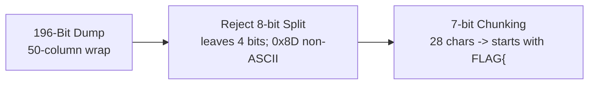

## The dump

In this practice puzzle, a fictional terminal emits a flag in the form `FLAG{...}`. Its diagnostic dump starts at the first bit of the first character and ends at the last bit of the final one. Every character occupies the same number of bits. The terminal writes the most significant bit first. The export wraps after 50 columns, including in the middle of a character.

```text
10001101001100100000110001111111011111001111001011
11011011001011101110101111111000101101001111010010
11111110000111100111100011110100111010011011111110
0110111001011000011101101110010111100111111101
```

Try finding a character width that fits the whole dump and gives the expected flag prefix.

## Count before decoding

Join the lines before counting them. The export contains 196 bits, so there is a quick test for any proposed character width. It must divide 196 evenly under the prompt's complete-record rule. Groups of eight leave four bits behind. The first eight bits, `10001101`, also give `0x8D`, which falls outside ASCII. Padding the last group would leave the first value unchanged.

Fourteen divides 196 evenly, but the first fourteen bits give `9036`. Four divides evenly too, but the first four bits give `8`, the ASCII backspace control character. The division check narrows the search. It takes a known character to decide whether a width makes sense for this flag.

## Read the header as a control



ASCII defines 128 values using seven bits. When an ASCII value is stored in an eight-bit byte, the high bit is zero. The puzzle packs the seven bits directly. At this width, 196 bits leave exactly 28 characters. These are the first five groups.

```text
1000110  1001100  1000001  1000111  1111011
   F        L        A        G        {
```

There is another way to check the framing. Reversing the bits in the first seven-bit group gives `0110001`, which would be `1` instead of `F`. The expected header checks the bit order as well as the character width.

The display wrapping matters after the header. Fifty leaves a remainder of one when divided by seven. The first line therefore ends with the first bit of the eighth character. A decoder that resets at every line break would recover part of the prefix and then silently lose its place.

## Decode and repack the whole stream

```python
dump = """\
10001101001100100000110001111111011111001111001011
11011011001011101110101111111000101101001111010010
11111110000111100111100011110100111010011011111110
0110111001011000011101101110010111100111111101
"""

def decode_packed_ascii(dump):
    bits = "".join(dump.split())
    width = 7
    if not bits or set(bits) - {"0", "1"}:
        raise ValueError("Expected a binary stream")
    if len(bits) % width:
        raise ValueError("Incomplete ASCII character")
    return "".join(
        chr(int(bits[start : start + width], 2))
        for start in range(0, len(bits), width)
    )


bits = "".join(dump.split())
flag = decode_packed_ascii(dump)
assert len(bits) == 196 and len(flag) == 28
assert flag.startswith("FLAG{") and flag.endswith("}")
assert "".join(f"{ord(char):07b}" for char in flag) == bits
print(flag)
```

```text
FLAG{seven_bit_ascii_frames}
```

## Check how the decoder fails

Try passing `bits[:-1]` to `decode_packed_ascii`. The missing bit leaves an incomplete final character and raises `ValueError`. With the original dump, the length checks and the closing brace account for the end of the record. Repacking the 28 values with seven places each then produces the original 196 bits. These checks catch a decoder that returns a plausible-looking prefix and drops the rest.

[RFC 20, section 3 — ASCII character representation](https://www.rfc-editor.org/rfc/rfc20.html).
